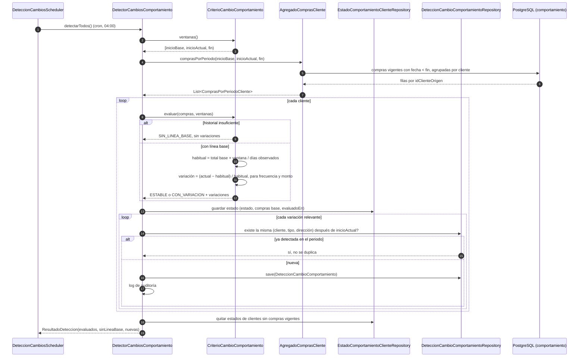
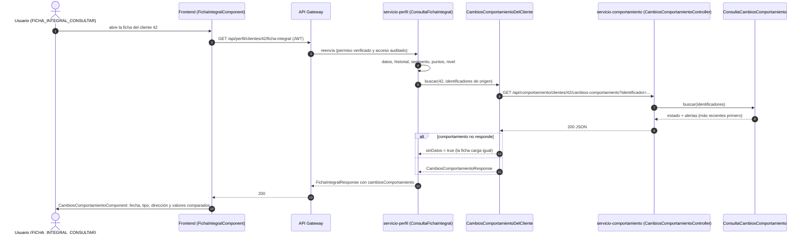

# Diagramas de la detección de cambios de comportamiento (SCRUM-580)

Diagrama de clases y diagramas de secuencia de la detección de variaciones en la frecuencia o el
monto de compra (SCRUM-34). La lógica que implementan está en `docs/compra/cambios-comportamiento.md`.
Están escritos en Mermaid: GitHub los dibuja al abrir este archivo, y para adjuntarlos a la historia en
Jira se exportan como imagen desde <https://mermaid.live>.

## Diagrama de clases

Paquete `cambio` de `servicio-comportamiento`, la agregación de compras que lo alimenta, y los bloques
que muestran las alertas en `servicio-perfil` y en el frontend.

```mermaid
classDiagram
    direction LR

    class TipoVariacion {
        <<enumeration>>
        FRECUENCIA
        MONTO
    }
    class DireccionVariacion {
        <<enumeration>>
        AUMENTO
        DISMINUCION
    }
    class EstadoComportamiento {
        <<enumeration>>
        SIN_LINEA_BASE
        ESTABLE
        CON_VARIACION
    }
    class Ventanas {
        <<record>>
        +OffsetDateTime inicioBase
        +OffsetDateTime inicioActual
        +OffsetDateTime fin
    }
    class Variacion {
        <<record>>
        +TipoVariacion tipo
        +DireccionVariacion direccion
        +BigDecimal actual
        +BigDecimal habitual
        +BigDecimal relativa
    }
    class Evaluacion {
        <<record>>
        +EstadoComportamiento estado
        +int comprasLineaBase
        +List~Variacion~ variaciones
    }
    class CriterioCambioComportamiento {
        -int ventanaDias
        -int periodosBase
        -int minimoComprasBase
        -BigDecimal umbral
        -Clock reloj
        +ventanas() Ventanas
        +evaluar(ComprasPorPeriodoCliente compras, Ventanas ventanas) Evaluacion
    }
    class DetectorCambiosComportamiento {
        +detectarTodos() ResultadoDeteccion
    }
    class DeteccionCambiosScheduler {
        +ejecutar()
    }
    class DeteccionCambioComportamiento {
        <<entity>>
        -Long id
        -String idClienteOrigen
        -TipoVariacion tipo
        -DireccionVariacion direccion
        -BigDecimal valorActual
        -BigDecimal valorHabitual
        -BigDecimal variacion
        -BigDecimal umbral
        -OffsetDateTime periodoDesde
        -OffsetDateTime periodoHasta
        -OffsetDateTime detectadoEn
    }
    class EstadoComportamientoCliente {
        <<entity>>
        -String idClienteOrigen
        -EstadoComportamiento estado
        -int comprasLineaBase
        -OffsetDateTime evaluadoEn
        +actualizar(estado, comprasLineaBase, evaluadoEn)
    }
    class DeteccionCambioComportamientoRepository {
        <<interface>>
        +existsBy...DetectadoEnAfter(cliente, tipo, direccion, desde) boolean
        +findByIdClienteOrigenIn...(identificadores, pageable) List
    }
    class EstadoComportamientoClienteRepository {
        <<interface>>
    }
    class ConsultaCambiosComportamiento {
        +buscar(List~Identificador~ identificadores) CambiosComportamiento
    }
    class CambiosComportamientoController {
        +buscar(String clienteId, List~String~ identificador) CambiosComportamiento
    }

    class AgregadoComprasCliente {
        +comprasPorPeriodo(inicioBase, inicioActual, fin) List~ComprasPorPeriodoCliente~
    }
    class ComprasPorPeriodoCliente {
        <<record>>
        +String idClienteOrigen
        +OffsetDateTime primeraCompra
        +Long comprasBase
        +BigDecimal montoBase
        +Long comprasActual
        +BigDecimal montoActual
    }

    class CambiosComportamientoDelCliente {
        <<servicio-perfil>>
        +buscar(Long clienteId, List~ClienteOrigen~ origenes) CambiosComportamientoResponse
    }
    class ConsultaFichaIntegral {
        <<servicio-perfil>>
        +obtener(Long clienteId) FichaIntegralResponse
    }
    class CambiosComportamientoComponent {
        <<frontend>>
        +cambios CambiosComportamientoFicha
    }

    DeteccionCambiosScheduler --> DetectorCambiosComportamiento
    DetectorCambiosComportamiento --> AgregadoComprasCliente
    DetectorCambiosComportamiento --> CriterioCambioComportamiento
    DetectorCambiosComportamiento --> DeteccionCambioComportamientoRepository
    DetectorCambiosComportamiento --> EstadoComportamientoClienteRepository
    AgregadoComprasCliente ..> ComprasPorPeriodoCliente : agrega
    CriterioCambioComportamiento ..> Ventanas : calcula
    CriterioCambioComportamiento ..> Evaluacion : produce
    Evaluacion o-- Variacion
    Evaluacion --> EstadoComportamiento
    Variacion --> TipoVariacion
    Variacion --> DireccionVariacion
    DeteccionCambioComportamientoRepository ..> DeteccionCambioComportamiento
    EstadoComportamientoClienteRepository ..> EstadoComportamientoCliente
    CambiosComportamientoController --> ConsultaCambiosComportamiento
    ConsultaCambiosComportamiento --> DeteccionCambioComportamientoRepository
    ConsultaCambiosComportamiento --> EstadoComportamientoClienteRepository
    ConsultaFichaIntegral --> CambiosComportamientoDelCliente
    CambiosComportamientoDelCliente ..> CambiosComportamientoController : GET HTTP
    CambiosComportamientoComponent ..> ConsultaFichaIntegral : ficha integral vía Gateway
```

## Diagrama de secuencia: evaluación periódica de un cliente contra su línea base

## Diagrama de secuencia: el usuario ve la alerta en la ficha integral

