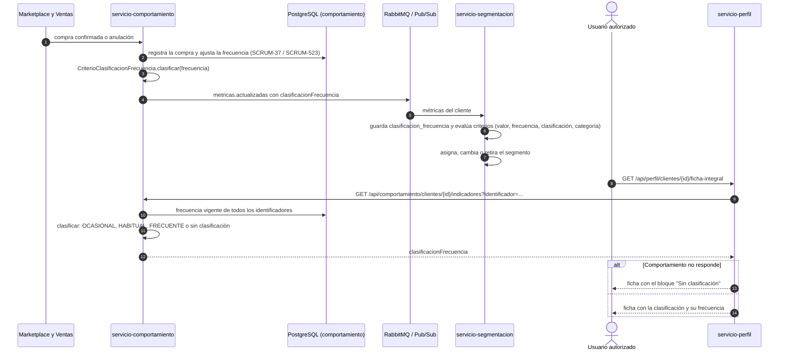

# Diagramas de la clasificación por frecuencia (SCRUM-584)

Diagrama de clases y diagrama de secuencia de SCRUM-38. La lógica está en
`docs/compra/clasificacion-frecuencia.md`. Están escritos en Mermaid: GitHub los dibuja al abrir este
archivo, y para adjuntarlos a la historia en Jira se exportan como imagen desde <https://mermaid.live>.

## Diagrama de clases

```mermaid
classDiagram
    direction LR

    class ClasificacionFrecuencia {
        <<enum>>
        OCASIONAL
        HABITUAL
        FRECUENTE
    }
    class CriterioClasificacionFrecuencia {
        -long umbralHabitual = 4
        -long umbralFrecuente = 10
        +clasificar(long frecuencia) Optional~ClasificacionFrecuencia~
    }
    class ClasificacionFrecuenciaCliente {
        <<record>>
        +ClasificacionFrecuencia clasificacion
        +long frecuencia
        +boolean sinClasificacion
        +de(long frecuencia, CriterioClasificacionFrecuencia)$
    }
    class ConsultaIndicadores {
        +frecuencia(List~Identificador~) long
        +clasificacionFrecuencia(List~Identificador~) ClasificacionFrecuenciaCliente
    }
    class FrecuenciaCompraRepository {
        <<repository SCRUM-37>>
        +sumar(identificadores) long
    }
    class IndicadoresController {
        +indicadores(clienteId, identificadores) IndicadoresCliente
    }
    class CalculoMetricasCliente {
        +calcular(idEvento, tipo, idCliente) MetricasCliente
    }
    class ClasificacionFrecuenciaDelCliente {
        <<servicio-perfil>>
        +buscar(clienteId, identificadoresOrigen) ClasificacionFrecuenciaResponse
    }
    class ConsultaFichaIntegral {
        <<servicio-perfil>>
        +obtener(clienteId) FichaIntegralResponse
    }
    class ReglaPrioridadSegmento {
        <<servicio-segmentacion>>
        +elegir(criterios, frecuencia, valor, categorias, clasificacion)$ Optional~Criterio~
    }
    class Criterio {
        <<servicio-segmentacion>>
        +Indicador indicador
        +String clasificacion
    }
    class ClasificacionFrecuenciaComponent {
        <<frontend>>
    }

    CriterioClasificacionFrecuencia ..> ClasificacionFrecuencia : clasifica
    ClasificacionFrecuenciaCliente --> ClasificacionFrecuencia
    ConsultaIndicadores --> FrecuenciaCompraRepository : reutiliza la frecuencia
    ConsultaIndicadores --> CriterioClasificacionFrecuencia
    ConsultaIndicadores ..> ClasificacionFrecuenciaCliente : produce
    IndicadoresController --> ConsultaIndicadores
    CalculoMetricasCliente --> CriterioClasificacionFrecuencia : métricas de SCRUM-26
    ConsultaFichaIntegral --> ClasificacionFrecuenciaDelCliente
    ClasificacionFrecuenciaDelCliente ..> IndicadoresController : GET indicadores
    ClasificacionFrecuenciaComponent ..> ConsultaFichaIntegral : GET ficha-integral
    ReglaPrioridadSegmento ..> Criterio : CLASIFICACION_FRECUENCIA
```

## Diagrama de secuencia: reclasificación cuando cambia la frecuencia

