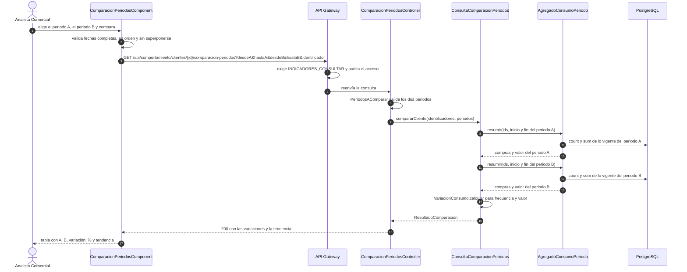
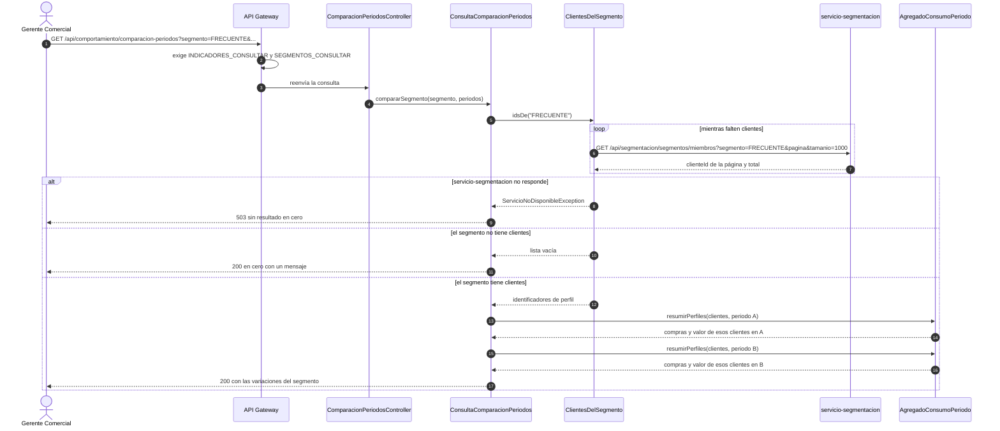
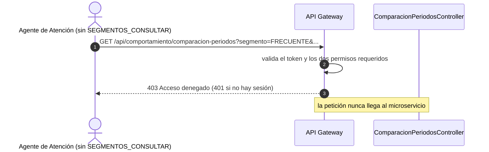

# Diagramas de la comparación entre periodos (SCRUM-587)

Diagrama de clases y diagramas de secuencia de la comparación de la frecuencia y el valor de compra
entre dos periodos, para un cliente o para un segmento (SCRUM-40). La lógica que implementan está en
`docs/compra/comparacion-periodos.md`. Están escritos en Mermaid: GitHub los dibuja al abrir este
archivo, y para adjuntarlos a la historia en Jira se exportan como imagen desde <https://mermaid.live>.

## Diagrama de clases

Paquete `comparacion` de `servicio-comportamiento`, la agregación que reutiliza del paquete `periodo`
(SCRUM-39), la consulta de segmentos en `servicio-segmentacion` y los componentes del frontend.

```mermaid
classDiagram
    direction LR

    namespace frontend {
        class ComparacionPeriodosComponent {
            +alcance: CLIENTE | SEGMENTO
            +segmento: string
            +desdeA, hastaA, desdeB, hastaB: string
            +comparar()
            +porcentaje(variacion) string
        }
        class ComparacionPeriodosService {
            +compararCliente(idCliente, identificadores, periodos) Observable
            +compararSegmento(segmento, periodos) Observable
        }
    }

    namespace comparacion {
        class ComparacionPeriodosController {
            +compararCliente(clienteId, identificadores, desdeA, hastaA, desdeB, hastaB) ResultadoComparacion
            +compararSegmento(segmento, desdeA, hastaA, desdeB, hastaB) ResultadoComparacion
        }
        class ConsultaComparacionPeriodos {
            -ZoneId zona
            +compararCliente(List~Identificador~ ids, PeriodosAComparar periodos) ResultadoComparacion
            +compararSegmento(String segmento, PeriodosAComparar periodos) ResultadoComparacion
        }
        class PeriodosAComparar {
            <<record>>
            +RangoPeriodo a
            +RangoPeriodo b
            +de(desdeA, hastaA, desdeB, hastaB)$ PeriodosAComparar
        }
        class ClientesDelSegmento {
            +idsDe(String segmento) List~Long~
        }
        class ResultadoComparacion {
            <<record>>
            +AlcanceComparacion alcance
            +RangoPeriodo periodoA
            +RangoPeriodo periodoB
            +VariacionConsumo frecuencia
            +VariacionConsumo valor
            +boolean sinDatos
            +String mensaje
        }
        class VariacionConsumo {
            <<record>>
            +BigDecimal periodoA
            +BigDecimal periodoB
            +BigDecimal variacionAbsoluta
            +BigDecimal variacionPorcentual
            +TendenciaConsumo tendencia
            +calcular(a, b)$ VariacionConsumo
        }
        class TendenciaConsumo {
            <<enumeration>>
            CRECE
            DECAE
            ESTABLE
            NUEVO
        }
    }

    namespace periodo {
        class RangoPeriodo {
            <<record>>
            +LocalDate desde
            +LocalDate hasta
            +inicio(ZoneId) OffsetDateTime
            +fin(ZoneId) OffsetDateTime
        }
        class AgregadoConsumoPeriodo {
            +resumir(List~Identificador~ ids, inicio, fin) ResumenCompras
            +resumirPerfiles(List~Long~ idsPerfil, inicio, fin) ResumenCompras
        }
    }

    namespace segmentacion {
        class ClientesDeSegmentoController {
            +buscar(String segmento, int pagina, int tamanio) ClientesDeSegmento
        }
        class SegmentoClienteRepository {
            <<interface>>
            +findBySegmentoOrderByClienteId(String segmento, Pageable) Page
        }
    }

    class ManejadorDeErrores {
        +reglaNegocio() 400
        +servicioNoDisponible() 503
    }

    ComparacionPeriodosComponent --> ComparacionPeriodosService
    ComparacionPeriodosService ..> ComparacionPeriodosController : GET
    ComparacionPeriodosController --> ConsultaComparacionPeriodos
    ComparacionPeriodosController --> PeriodosAComparar : valida los periodos
    ComparacionPeriodosController ..> ManejadorDeErrores
    PeriodosAComparar --> RangoPeriodo
    ConsultaComparacionPeriodos --> AgregadoConsumoPeriodo : una agregación por periodo
    ConsultaComparacionPeriodos --> ClientesDelSegmento : alcance de segmento
    ConsultaComparacionPeriodos --> ResultadoComparacion
    ResultadoComparacion --> VariacionConsumo
    VariacionConsumo --> TendenciaConsumo
    ClientesDelSegmento ..> ClientesDeSegmentoController : GET /api/segmentacion/segmentos/miembros?segmento=
    ClientesDeSegmentoController --> SegmentoClienteRepository
```

## Diagrama de secuencia: comparar un cliente

Criterios de aceptación 1 y 3.

## Diagrama de secuencia: comparar un segmento

Criterio de aceptación 2.

## Diagrama de secuencia: usuario sin permiso

