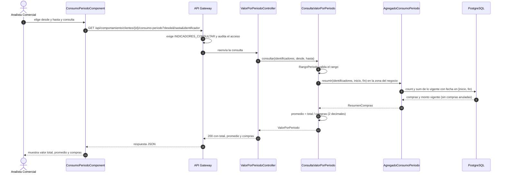
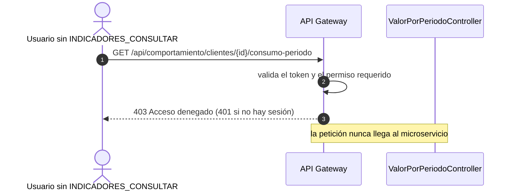

# Diagramas de la consulta del valor consumido por periodo (SCRUM-586)

Diagrama de clases y diagrama de secuencia de la consulta del valor total y promedio de un cliente en
un periodo (SCRUM-39). La lógica que implementan está en `docs/compra/consumo-por-periodo.md`. Están
escritos en Mermaid: GitHub los dibuja al abrir este archivo, y para adjuntarlos a la historia en
Jira se exportan como imagen desde <https://mermaid.live>.

## Diagrama de clases

Paquete `periodo` de `servicio-comportamiento` y el componente del frontend que lo consume.

```mermaid
classDiagram
    direction LR

    namespace frontend {
        class ConsumoPeriodoComponent {
            +desde: string
            +hasta: string
            +resultado: ValorPorPeriodo
            +consultar()
            +nota(valor) string
        }
        class ConsumoPeriodoService {
            +consultar(idCliente, identificadores, desde, hasta) Observable~ValorPorPeriodo~
        }
    }

    namespace periodo {
        class ValorPorPeriodoController {
            +consumoPorPeriodo(clienteId, identificadores, desde, hasta) ValorPorPeriodo
        }
        class ConsultaValorPorPeriodo {
            -ZoneId zona
            +consultar(List~Identificador~ identificadores, LocalDate desde, LocalDate hasta) ValorPorPeriodo
        }
        class RangoPeriodo {
            <<record>>
            +LocalDate desde
            +LocalDate hasta
            +DIAS_MAXIMOS$ long
            +inicio(ZoneId zona) OffsetDateTime
            +fin(ZoneId zona) OffsetDateTime
        }
        class AgregadoConsumoPeriodo {
            +resumir(List~Identificador~ ids, OffsetDateTime inicio, OffsetDateTime fin) ResumenCompras
        }
        class ValorPorPeriodo {
            <<record>>
            +LocalDate desde
            +LocalDate hasta
            +String zonaHoraria
            +BigDecimal total
            +BigDecimal promedio
            +long compras
            +boolean sinDatos
            +String mensaje
            +de(RangoPeriodo rango, String zona, ResumenCompras resumen)$ ValorPorPeriodo
        }
    }

    namespace compra {
        class ComprasDelCliente {
            +deIdentificadores(...)$ Predicate
            +vigente(...)$ Predicate
            +montoVigente(...)$ Expression
        }
        class ResumenCompras {
            <<record>>
            +long compras
            +BigDecimal monto
        }
        class Compra
    }

    class ManejadorDeErrores {
        +reglaNegocio(ReglaNegocioException) ResponseEntity
        +parametroInvalido(MethodArgumentTypeMismatchException) ResponseEntity
    }

    ConsumoPeriodoComponent --> ConsumoPeriodoService
    ConsumoPeriodoService ..> ValorPorPeriodoController : GET .../consumo-periodo
    ValorPorPeriodoController --> ConsultaValorPorPeriodo
    ValorPorPeriodoController ..> ManejadorDeErrores : 400
    ConsultaValorPorPeriodo --> RangoPeriodo : valida el rango
    ConsultaValorPorPeriodo --> AgregadoConsumoPeriodo
    ConsultaValorPorPeriodo --> ValorPorPeriodo
    AgregadoConsumoPeriodo --> ComprasDelCliente : mismas condiciones de vigente
    AgregadoConsumoPeriodo --> Compra
    AgregadoConsumoPeriodo --> ResumenCompras
    ValorPorPeriodo --> ResumenCompras
```

## Diagrama de secuencia: consulta con compras en el periodo

Criterios de aceptación 1 y 2.

## Diagrama de secuencia: periodo sin compras y rango inválido

Criterios de aceptación 3 y 4.

```mermaid
sequenceDiagram
    autonumber
    actor U as Usuario
    participant W as ConsumoPeriodoComponent
    participant C as ValorPorPeriodoController
    participant S as ConsultaValorPorPeriodo
    participant A as AgregadoConsumoPeriodo
    participant E as ManejadorDeErrores

    alt rango incompleto o al revés (desde el frontend)
        U->>W: consulta con fechas incompletas o desde posterior a hasta
        W-->>U: avisa el problema sin llamar al servidor
    else el servidor recibe un rango inválido
        W->>C: GET ...?desde=2026-09-30&hasta=2026-09-01
        C->>S: consultar(...)
        S->>S: RangoPeriodo rechaza el rango
        S-->>E: ReglaNegocioException
        E-->>W: 400 con el mensaje del error
    else periodo sin compras vigentes
        W->>C: GET ...?desde=2026-01-01&hasta=2026-01-31
        C->>S: consultar(...)
        S->>A: resumir(...)
        A-->>S: ResumenCompras vacío
        S-->>C: total 0, promedio 0, sinDatos y mensaje
        C-->>W: 200
        W-->>U: muestra cero con el mensaje
    end
```

## Diagrama de secuencia: usuario sin permiso

