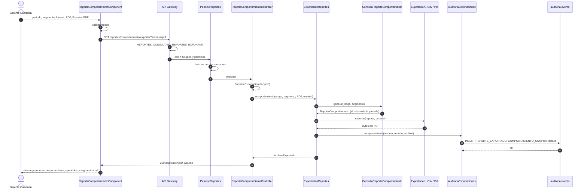
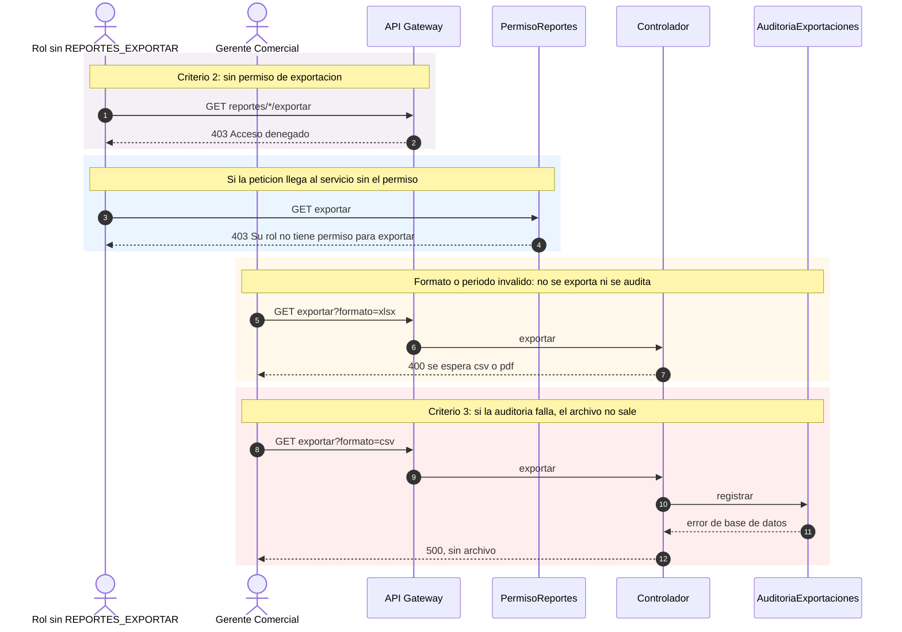

# Diagramas de la exportación de reportes a CSV y PDF (SCRUM-613)

Diagrama de clases y de secuencia de SCRUM-60. Los formatos, la API, el permiso y la auditoría están en
[exportacion-reportes.md](exportacion-reportes.md). Están escritos en Mermaid: GitHub los dibuja al abrir este
archivo, y para adjuntarlos a la historia en Jira se exportan como imagen.

## Diagrama de clases

```mermaid
classDiagram
    direction LR

    class ExportarReporteComponent {
        <<Angular, SCRUM-480>>
        +formato csv o pdf
        +exportar(formato)
        visible con REPORTES_EXPORTAR
    }
    class ReporteComportamientoComponent {
        <<Angular, SCRUM-58>>
        +exportar(formato)
    }
    class ReporteComparativoComponent {
        <<Angular, SCRUM-62>>
        +exportar(formato)
    }
    class SecurityConfig {
        <<API Gateway, SCRUM-482>>
        reportes/*/exportar y comparativo/csv:
        REPORTES_CONSULTAR y REPORTES_EXPORTAR
    }
    class PermisoReportes {
        <<interceptor, SCRUM-482>>
        Control(REPORTES_CONSULTAR)
        Control(REPORTES_EXPORTAR)
    }
    class ReporteComportamientoController {
        +comportamiento(desde, hasta, segmento)
        +exportar(formato, desde, hasta, segmento, usuario)
    }
    class ReporteComparativoController {
        +comparar(desdeA, hastaA, desdeB, hastaB, segmento)
        +exportar(formato, ..., usuario)
        +exportarCsv(..., usuario)
    }
    class FormatoExportacion {
        <<enum, SCRUM-479>>
        CSV text/csv UTF-8
        PDF application/pdf
        +de(valor) 400 si es desconocido
    }
    class ExportacionReportes {
        <<servicio, SCRUM-60>>
        +comportamiento(rango, segmento, formato, usuario) ArchivoExportado
        +comparativo(periodos, segmento, formato, usuario) ArchivoExportado
    }
    class ConsultaReporteComportamiento {
        <<SCRUM-58>>
        +generar(rango, segmento)
    }
    class ConsultaReporteComparativo {
        <<SCRUM-62>>
        +generar(periodos, segmento)
    }
    class ExportacionComportamientoCsv {
        <<SCRUM-483>>
        +exportar(reporte) String
    }
    class ExportacionComparativoCsv {
        <<SCRUM-499>>
        +exportar(reporte) String
    }
    class EscrituraCsv {
        <<RFC 4180, BOM, CRLF>>
        +escribir(filas)
    }
    class ExportacionComportamientoPdf {
        <<SCRUM-481>>
        +exportar(reporte, usuario) byte[]
    }
    class ExportacionComparativoPdf {
        <<SCRUM-481>>
        +exportar(reporte, usuario) byte[]
    }
    class DocumentoPdf {
        <<OpenPDF, A4, Helvetica>>
        +encabezado(pares)
        +tabla(titulos, anchos, numericas, filas)
        +cerrar() byte[]
    }
    class AuditoriaExportaciones {
        <<SCRUM-484>>
        +comportamiento(usuario, reporte, archivo)
        +comparativo(usuario, reporte, archivo)
    }
    class ArchivoExportado {
        <<record>>
        +nombre
        +formato
        +contenido
        +respuesta() adjunto
    }

    ReporteComportamientoComponent *-- ExportarReporteComponent
    ReporteComparativoComponent *-- ExportarReporteComponent
    ReporteComportamientoComponent ..> SecurityConfig : GET exportar
    ReporteComparativoComponent ..> SecurityConfig : GET exportar
    SecurityConfig ..> ReporteComportamientoController
    SecurityConfig ..> ReporteComparativoController
    PermisoReportes ..> ReporteComportamientoController : intercepta
    PermisoReportes ..> ReporteComparativoController : intercepta
    ReporteComportamientoController --> FormatoExportacion
    ReporteComparativoController --> FormatoExportacion
    ReporteComportamientoController --> ExportacionReportes
    ReporteComparativoController --> ExportacionReportes
    ExportacionReportes --> ConsultaReporteComportamiento : el mismo reporte de pantalla
    ExportacionReportes --> ConsultaReporteComparativo : el mismo reporte de pantalla
    ExportacionReportes --> ExportacionComportamientoCsv
    ExportacionReportes --> ExportacionComparativoCsv
    ExportacionReportes --> ExportacionComportamientoPdf
    ExportacionReportes --> ExportacionComparativoPdf
    ExportacionReportes --> AuditoriaExportaciones : antes de entregar
    ExportacionReportes --> ArchivoExportado : arma
    ExportacionComportamientoCsv ..> EscrituraCsv
    ExportacionComparativoCsv ..> EscrituraCsv
    ExportacionComportamientoPdf ..> DocumentoPdf
    ExportacionComparativoPdf ..> DocumentoPdf
    ExportacionComportamientoPdf ..> ExportacionComportamientoCsv : mismos indicadores y alcance
```

## Diagrama de secuencia

Exportar el reporte de comportamiento de compra (el comparativo sigue el mismo camino con
`ConsultaReporteComparativo` y sus exportadores).

Los casos que no son el normal.

## Pruebas

| Prueba | Qué comprueba |
|---|---|
| `ExportacionComportamientoCsvTest` | Formato del CSV del comportamiento (BOM, CRLF, comillas, vacíos, sin datos) y nombre del archivo |
| `ExportacionReportesPdfTest` | Contenido de los dos PDF leído con el extractor de texto, números como en pantalla y pie con el usuario |
| `ExportacionReportesIntegracionTest` | Con PostgreSQL real: CSV y PDF con los mismos valores que el JSON (criterio 1), 403 sin `REPORTES_EXPORTAR` (criterio 2), registro en `auditoria.evento` con quién, qué y cuándo (criterio 3), 400 sin auditar |
| `ReporteComparativoIntegracionTest` | La ruta `comparativo/csv` de SCRUM-499 ahora exige `REPORTES_EXPORTAR` y se audita |
| `AccesoPorRolTest` (Gateway) | Las rutas de exportación para Gerente y Administrador; 403 con solo `REPORTES_CONSULTAR` o solo `REPORTES_EXPORTAR` |
| `e2e/scrum60.spec.ts` | En el navegador: descarga de CSV y PDF, valores del CSV contra la pantalla, 403 del Agente y la auditoría vista por el Administrador |
