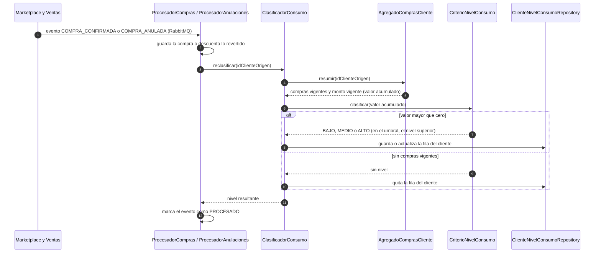
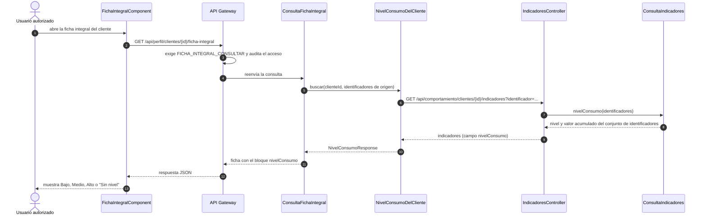
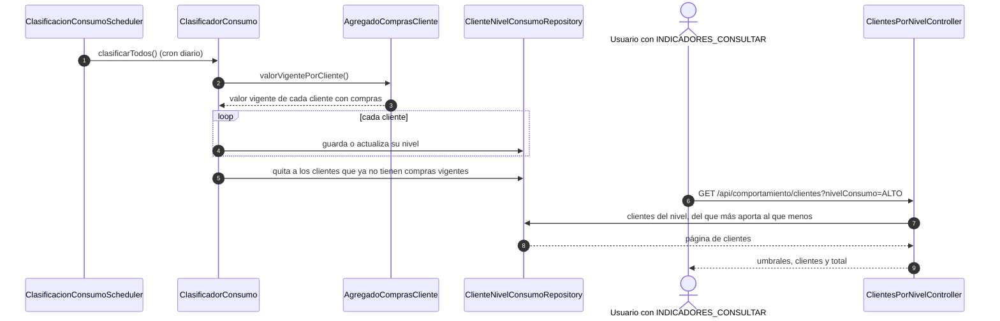

# Diagramas del nivel de consumo del cliente (SCRUM-575)

Diagrama de clases y diagrama de secuencia de la clasificación por nivel de consumo (SCRUM-27). La
lógica que implementan está en `docs/compra/nivel-consumo.md`. Están escritos en Mermaid: GitHub los
dibuja al abrir este archivo, y para adjuntarlos a la historia en Jira se exportan como imagen desde
<https://mermaid.live>.

## Diagrama de clases

Paquete `consumo` de `servicio-comportamiento`, sus puntos de enganche con la ingesta y los
indicadores, y los bloques que consumen el nivel en `servicio-perfil` y en el frontend.

```mermaid
classDiagram
    direction LR

    class NivelConsumo {
        <<enumeration>>
        BAJO
        MEDIO
        ALTO
    }
    class CriterioNivelConsumo {
        -BigDecimal umbralMedio
        -BigDecimal umbralAlto
        +clasificar(BigDecimal valor) Optional~NivelConsumo~
    }
    class ClasificadorConsumo {
        +reclasificar(String idClienteOrigen) Optional~NivelConsumo~
        +clasificarTodos() int
    }
    class ClasificacionConsumoScheduler {
        +ejecutar()
    }
    class ClienteNivelConsumo {
        -String idClienteOrigen
        -NivelConsumo nivel
        -BigDecimal valorAcumulado
        -OffsetDateTime actualizadoEn
        +actualizar(NivelConsumo nivel, BigDecimal valor)
    }
    class ClienteNivelConsumoRepository {
        <<interface>>
        +findByNivelOrderByValorAcumuladoDesc...(nivel, pageable) Page
    }
    class ConsultaClientesPorNivel {
        +buscar(NivelConsumo nivel, int pagina, int tamanio) Page
    }
    class ClientesPorNivelController {
        +buscar(String nivelConsumo, int pagina, int tamanio) ClientesPorNivel
    }
    class NivelConsumoCliente {
        <<record>>
        +NivelConsumo nivel
        +BigDecimal valorAcumulado
        +boolean sinNivel
        +de(ValorAcumulado valor, CriterioNivelConsumo criterio)$ NivelConsumoCliente
    }

    class AgregadoComprasCliente {
        +resumir(List~Identificador~) ResumenCompras
        +valorVigentePorCliente() List~ValorCliente~
    }
    class ValorAcumulado {
        <<record>>
        +de(ResumenCompras resumen)$ ValorAcumulado
    }
    class ConsultaIndicadores {
        +valorAcumulado(List~Identificador~) ValorAcumulado
        +nivelConsumo(List~Identificador~) NivelConsumoCliente
    }
    class IndicadoresController {
        +indicadores(String clienteId, List~String~ identificadores)
    }
    class ProcesadorCompras {
        +procesar(Long idEvento) Compra
    }
    class ProcesadorAnulaciones {
        +procesar(Long idEvento) Anulacion
    }

    class ConsultaFichaIntegral {
        +obtener(Long clienteId) FichaIntegralResponse
    }
    class NivelConsumoDelCliente {
        +buscar(Long clienteId, List~ClienteOrigen~ origenes) NivelConsumoResponse
    }
    class NivelConsumoComponent {
        +nivel: NivelConsumoFicha
        +nombreNivel(nivel) string
    }

    ClasificadorConsumo --> AgregadoComprasCliente : reutiliza el valor vigente
    ClasificadorConsumo --> CriterioNivelConsumo : aplica los umbrales
    ClasificadorConsumo --> ClienteNivelConsumoRepository : guarda o quita la fila
    ClasificacionConsumoScheduler --> ClasificadorConsumo : clasificarTodos()
    ProcesadorCompras --> ClasificadorConsumo : reclasifica al comprar
    ProcesadorAnulaciones --> ClasificadorConsumo : reclasifica al anular o devolver
    ClienteNivelConsumoRepository --> ClienteNivelConsumo
    ClienteNivelConsumo --> NivelConsumo
    CriterioNivelConsumo --> NivelConsumo
    ConsultaClientesPorNivel --> ClienteNivelConsumoRepository
    ClientesPorNivelController --> ConsultaClientesPorNivel
    ClientesPorNivelController --> CriterioNivelConsumo : expone los umbrales
    ConsultaIndicadores --> AgregadoComprasCliente
    ConsultaIndicadores --> ValorAcumulado
    ConsultaIndicadores --> NivelConsumoCliente
    NivelConsumoCliente --> CriterioNivelConsumo
    IndicadoresController --> ConsultaIndicadores
    NivelConsumoDelCliente ..> IndicadoresController : GET .../indicadores
    ConsultaFichaIntegral --> NivelConsumoDelCliente
    NivelConsumoComponent ..> ConsultaFichaIntegral : bloque nivelConsumo
```

## Diagrama de secuencia: una compra o una anulación cambia el nivel

Cubre los criterios de aceptación 1, 2 y 3. Todo ocurre en la transacción de la compra o de la
anulación: si esa transacción se revierte, la clasificación también.

## Diagrama de secuencia: el usuario ve el nivel en la ficha integral

Criterio de aceptación 4. Si `servicio-comportamiento` no responde, el bloque llega como "sin datos"
y el resto de la ficha carga igual.

## Diagrama de secuencia: clasificación programada y listado por nivel

