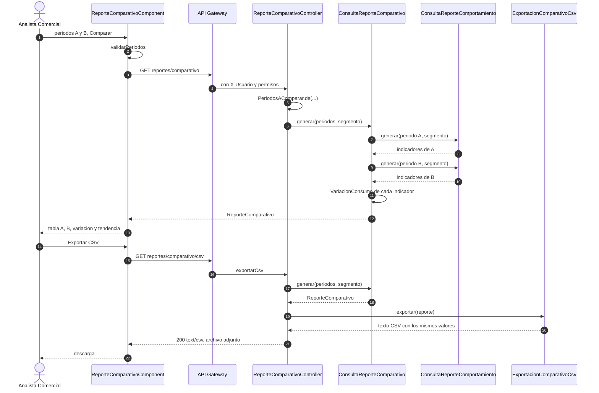
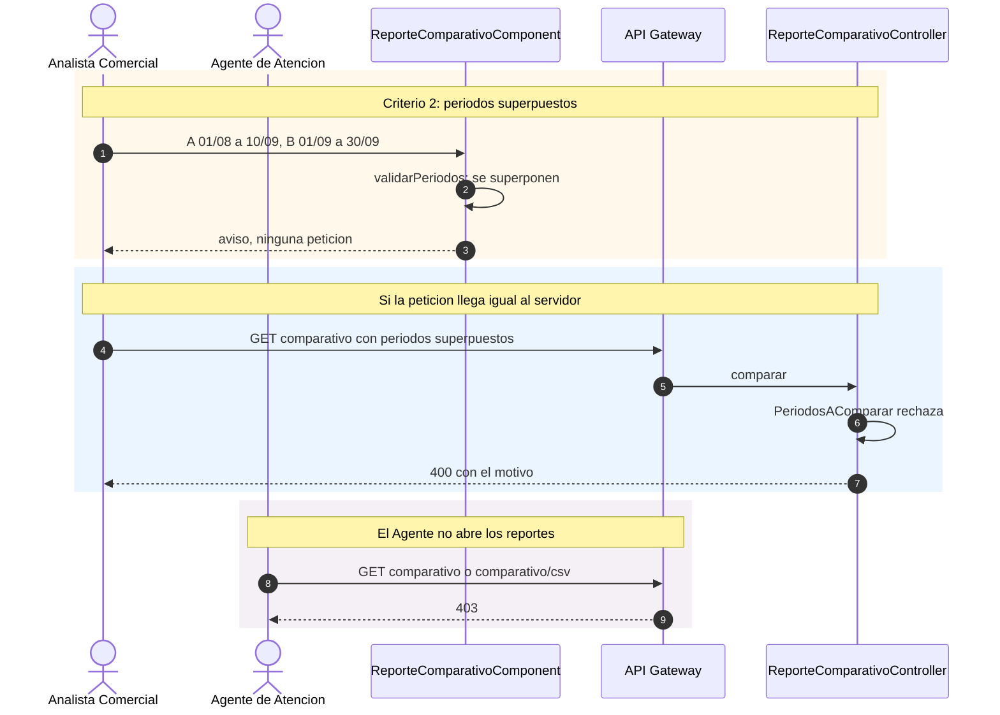

# Diagramas del reporte comparativo entre periodos (SCRUM-612)

Diagrama de clases y de secuencia de SCRUM-62. Los indicadores, las reglas de comparación y la exportación están
en [reporte-comparativo.md](reporte-comparativo.md). Están escritos en Mermaid: GitHub los dibuja al abrir este
archivo, y para adjuntarlos a la historia en Jira se exportan como imagen.

## Diagrama de clases

```mermaid
classDiagram
    direction LR

    class ReporteComparativoComponent {
        <<Angular, SCRUM-495>>
        +comparar()
        +exportar()
    }
    class validarPeriodos {
        <<funcion, SCRUM-494>>
        cada periodo con validarPeriodo
        y sin superponerse
    }
    class SecurityConfig {
        <<API Gateway>>
        GET comportamiento/reportes: REPORTES_CONSULTAR
    }
    class ReporteComparativoController {
        <<SCRUM-494>>
        +comparar(desdeA, hastaA, desdeB, hastaB, segmento)
        +exportarCsv(mismos parametros)
    }
    class PermisoReportes {
        <<interceptor, SCRUM-500>>
        comportamiento, comparativo y comparativo/csv
    }
    class PeriodosAComparar {
        <<SCRUM-40, compartido>>
        +de(desdeA, hastaA, desdeB, hastaB)
        sin superponerse
    }
    class ConsultaReporteComparativo {
        <<SCRUM-496>>
        +generar(periodos, segmento) ReporteComparativo
    }
    class ConsultaReporteComportamiento {
        <<SCRUM-58, SCRUM-497>>
        +generar(rango, segmento) ReporteComportamiento
    }
    class VariacionConsumo {
        <<SCRUM-40, compartido>>
        +calcular(a, b)
    }
    class ReporteComparativo {
        <<record>>
        +periodoA
        +periodoB
        +alcance
        +indicadores
    }
    class Indicador {
        <<record, SCRUM-498>>
        +codigo
        +periodoA
        +periodoB
        +variacionAbsoluta
        +variacionPorcentual
        +tendencia
    }
    class ExportacionComparativoCsv {
        <<SCRUM-499>>
        +exportar(reporte) String
    }

    ReporteComparativoComponent ..> validarPeriodos : antes de consultar
    ReporteComparativoComponent ..> SecurityConfig : GET
    SecurityConfig ..> ReporteComparativoController
    PermisoReportes ..> ReporteComparativoController : intercepta
    ReporteComparativoController --> PeriodosAComparar
    ReporteComparativoController --> ConsultaReporteComparativo
    ReporteComparativoController --> ExportacionComparativoCsv
    ConsultaReporteComparativo --> ConsultaReporteComportamiento : una vez por periodo
    ConsultaReporteComparativo --> ReporteComparativo : arma
    ReporteComparativo *-- Indicador
    Indicador ..> VariacionConsumo
    ExportacionComparativoCsv ..> ReporteComparativo : el mismo objeto
```

## Diagrama de secuencia

Comparar y exportar.

Los casos que no son el normal.

