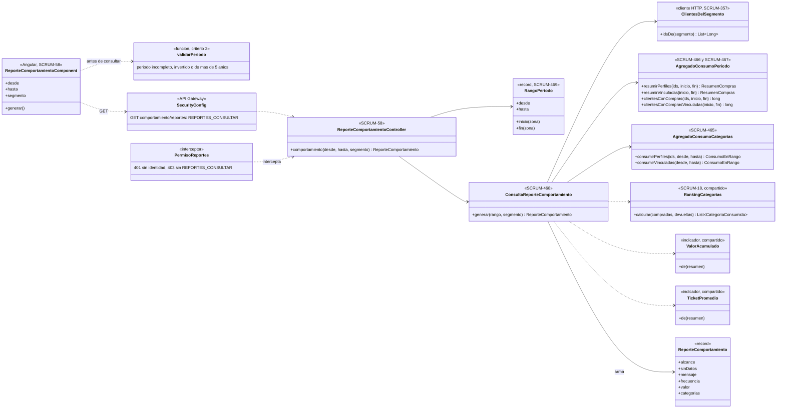
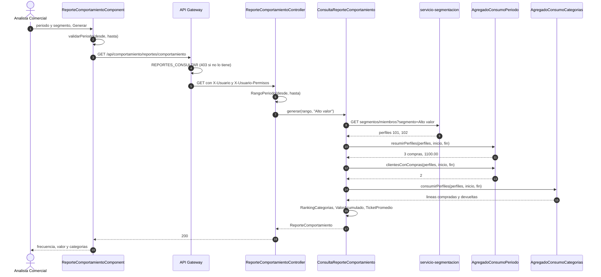
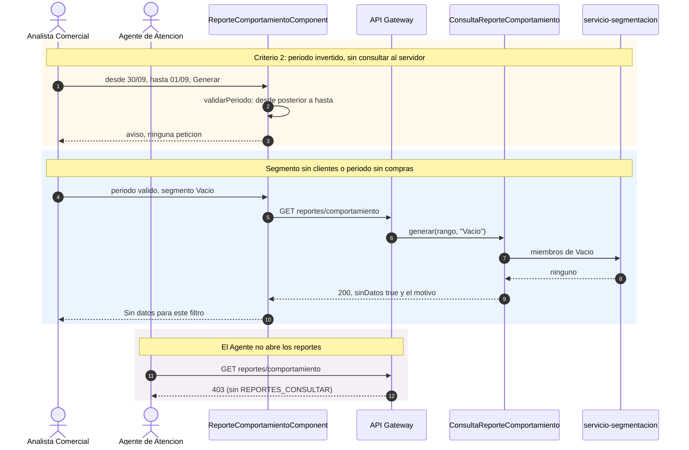

# Diagramas del reporte de comportamiento de compra (SCRUM-610)

Diagrama de clases y de secuencia de SCRUM-58. La consulta base, los cortes y los permisos están en
[reportes-comportamiento.md](reportes-comportamiento.md). Están escritos en Mermaid: GitHub los dibuja al
abrir este archivo, y para adjuntarlos a la historia en Jira se exportan como imagen.

## Diagrama de clases

## Diagrama de secuencia

Reporte de un segmento en un periodo.

Los casos que no son el normal.

