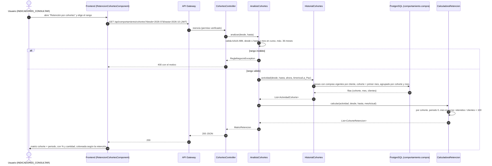

# Diagramas de la retención por cohortes (SCRUM-582)

Diagrama de clases y diagrama de secuencia del análisis de retención por cohortes de primera compra
(SCRUM-36). La lógica que implementan está en `docs/compra/retencion-cohortes.md`. Están escritos en
Mermaid: GitHub los dibuja al abrir este archivo, y para adjuntarlos a la historia en Jira se exportan
como imagen desde <https://mermaid.live>.

## Diagrama de clases

Paquete `cohorte` de `servicio-comportamiento` y la pantalla que muestra la matriz en el frontend.

```mermaid
classDiagram
    direction LR

    class CohortesController {
        +matriz(String desde, String hasta) MatrizRetencion
    }
    class AnalisisCohortes {
        -Clock reloj
        -ZoneId zona
        +analizar(String desde, String hasta) MatrizRetencion
    }
    class HistorialCohortes {
        <<repository>>
        +actividad(YearMonth desde, YearMonth hasta, OffsetDateTime hasta, ZoneId zona) List~ActividadCohorte~
    }
    class CalculadoraRetencion {
        <<utility>>
        +calcular(List~ActividadCohorte~ actividad, YearMonth desde, YearMonth hasta, YearMonth mesActual)$ List~CohorteRetencion~
    }
    class ActividadCohorte {
        <<record>>
        +YearMonth cohorte
        +YearMonth mes
        +long clientes
    }
    class MatrizRetencion {
        <<record>>
        +String granularidad
        +String zonaHoraria
        +YearMonth desde
        +YearMonth hasta
        +YearMonth mesActual
        +List~CohorteRetencion~ cohortes
    }
    class CohorteRetencion {
        <<record>>
        +YearMonth cohorte
        +long clientes
        +List~RetencionPeriodo~ periodos
    }
    class RetencionPeriodo {
        <<record>>
        +int periodo
        +YearMonth mes
        +long clientes
        +BigDecimal porcentaje
    }
    class Compra {
        <<entity>>
        +String idClienteOrigen
        +OffsetDateTime fecha
        +BigDecimal montoTotal
        +BigDecimal montoRevertido
    }
    class RetencionCohortesComponent {
        <<frontend>>
        +buscar()
        +fondo(RetencionPeriodo celda) String
    }
    class RetencionCohortesService {
        <<frontend>>
        +matriz(desde, hasta) Observable~MatrizRetencion~
    }

    CohortesController --> AnalisisCohortes
    AnalisisCohortes --> HistorialCohortes
    AnalisisCohortes ..> CalculadoraRetencion : calcula
    AnalisisCohortes ..> MatrizRetencion : produce
    HistorialCohortes ..> Compra : agrega compras vigentes
    HistorialCohortes ..> ActividadCohorte : devuelve
    CalculadoraRetencion ..> ActividadCohorte : usa
    CalculadoraRetencion ..> CohorteRetencion : produce
    MatrizRetencion o-- CohorteRetencion
    CohorteRetencion o-- RetencionPeriodo
    RetencionCohortesComponent --> RetencionCohortesService
    RetencionCohortesService ..> CohortesController : GET vía Gateway
```

## Diagrama de secuencia: generación y visualización de la matriz

