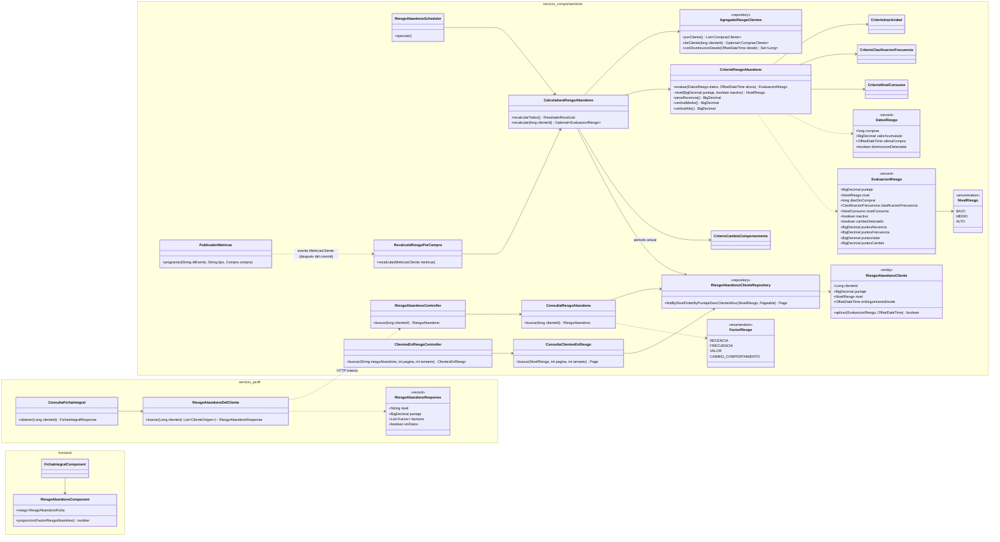
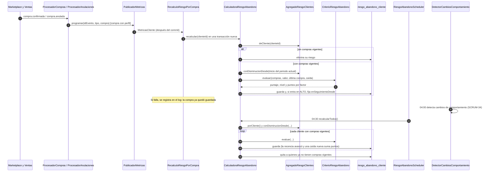
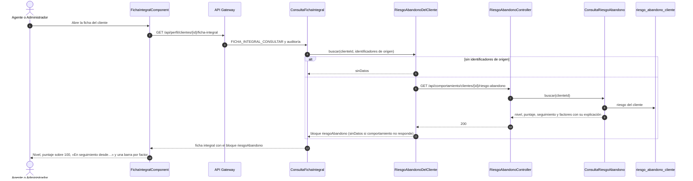

# Diagramas del riesgo de abandono (SCRUM-581)

Diagrama de clases y diagramas de secuencia de SCRUM-35. La fórmula, los niveles y las consultas están
en `docs/compra/riesgo-abandono.md`. Están escritos en Mermaid: GitHub los dibuja al abrir este
archivo, y para adjuntarlos a la historia en Jira se exportan como imagen desde
<https://mermaid.live>.

## Diagrama de clases

## Diagrama de secuencia: recálculo con cada compra y cada día

## Diagrama de secuencia: consulta en la ficha integral

