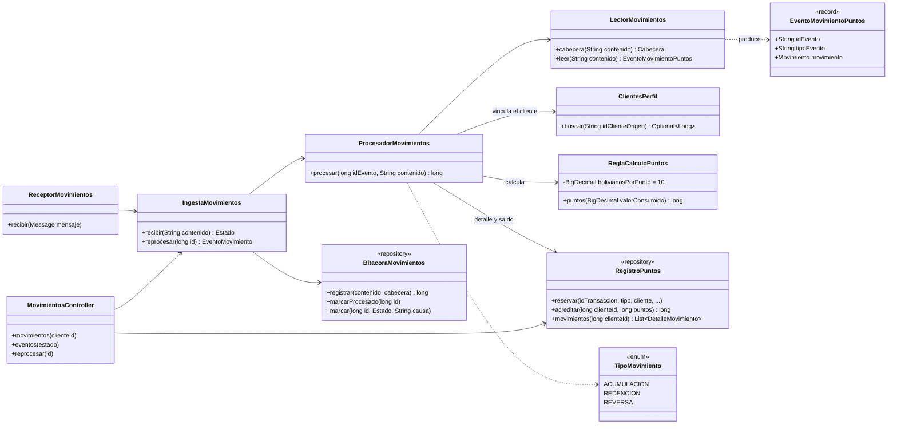
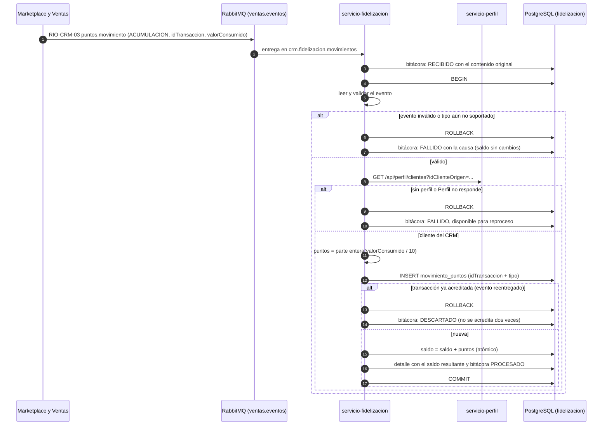

# Diagramas de la acumulación de puntos (SCRUM-593)

Diagrama de clases y diagrama de secuencia de la integración asíncrona de SCRUM-45. La lógica está en
`docs/fidelizacion/acumulacion-puntos.md` y el contrato en
`docs/contratos-eventos/RIO-CRM-03-movimiento-puntos.md`. Están escritos en Mermaid: GitHub los dibuja
al abrir este archivo, y para adjuntarlos a la historia en Jira se exportan como imagen desde
<https://mermaid.live>.

## Diagrama de clases

## Diagrama de secuencia: acumulación, reentrega y evento inválido

