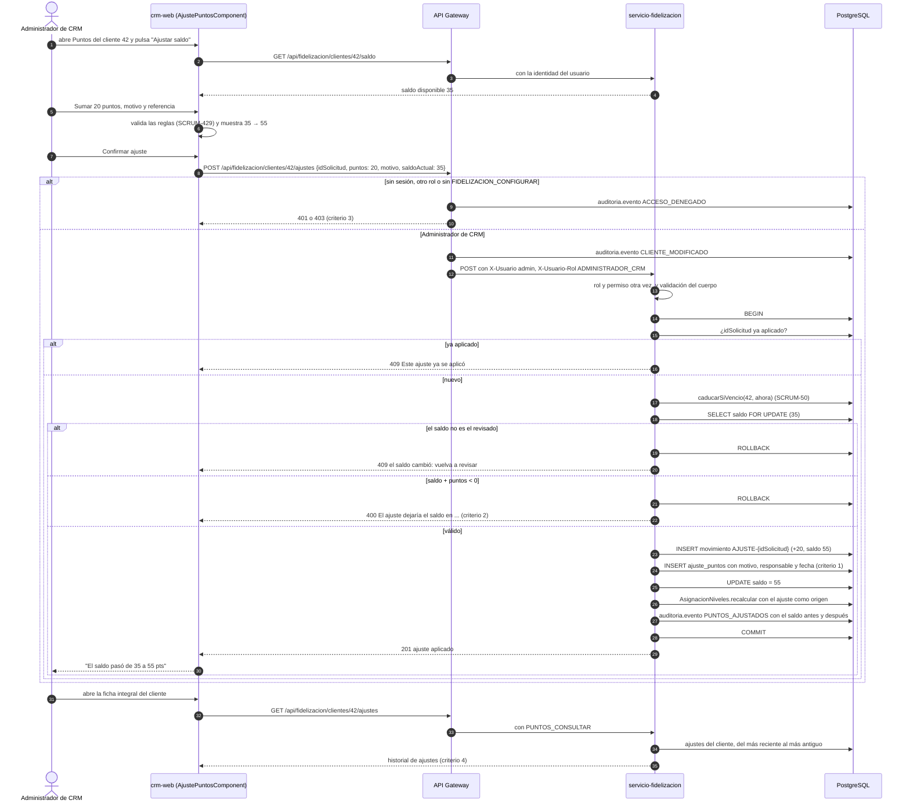

# Diagramas del ajuste manual de puntos (SCRUM-603)

Diagrama de clases y de secuencia de SCRUM-51. El modelo de auditoría y las reglas están en
`docs/fidelizacion/ajuste-manual-puntos.md`. Están escritos en Mermaid: GitHub los dibuja al abrir este archivo, y
para adjuntarlos a la historia en Jira se exportan como imagen desde <https://mermaid.live>.

## Diagrama de clases

```mermaid
classDiagram
    direction LR

    class AjustePuntosComponent {
        <<Angular, SCRUM-426>>
        +revisar()
        +confirmar()
    }
    class HistorialAjustesComponent {
        <<Angular, SCRUM-427>>
        +clienteId
    }
    class AjustesPuntosService {
        <<Angular>>
        +ajustar(clienteId, solicitud)
        +historial(clienteId)
    }
    class SecurityConfig {
        <<API Gateway, SCRUM-424>>
        POST ajustes: ADMINISTRADOR_CRM y FIDELIZACION_CONFIGURAR
    }
    class AjustesController {
        <<SCRUM-423>>
        +ajustar(clienteId, solicitud, req) Ajuste
        +historial(clienteId, req) List~Ajuste~
    }
    class SolicitudAjuste {
        <<record, SCRUM-429>>
        +UUID idSolicitud
        +Long puntos
        +String motivo
        +String referencia
        +Long saldoActual
    }
    class ServicioAjustes {
        <<SCRUM-422>>
        +ajustar(clienteId, solicitud, usuario, rol) Ajuste
        +historial(clienteId) List~Ajuste~
    }
    class RegistroAjustes {
        <<repository>>
        +yaAplicado(idSolicitud) boolean
        +bloquearSaldo(clienteId) long
        +registrarMovimiento(id, clienteId, puntos, saldo)
        +registrar(...) Ajuste
        +actualizarSaldo(clienteId, saldo)
        +deCliente(clienteId) List~Ajuste~
    }
    class AuditoriaAjustes {
        <<repository, SCRUM-425>>
        +registrar(ajuste)
    }
    class Ajuste {
        <<record, SCRUM-421>>
        +long id
        +String idTransaccion
        +long puntos
        +long saldoAnterior
        +long saldoResultante
        +String motivo
        +String usuario
        +OffsetDateTime registradoEn
    }
    class ProcesoCaducidad {
        <<SCRUM-50>>
        +caducarSiVencio(clienteId, momento)
    }
    class AsignacionNiveles {
        <<repository>>
        +recalcular(cliente, idTransaccion, tipo) Nivel
    }

    AjustePuntosComponent --> AjustesPuntosService
    HistorialAjustesComponent --> AjustesPuntosService
    AjustesPuntosService ..> SecurityConfig : HTTP con el token
    SecurityConfig ..> AjustesController : X-Usuario, X-Usuario-Rol, X-Usuario-Permisos
    AjustesController ..> SolicitudAjuste
    AjustesController --> ServicioAjustes
    ServicioAjustes --> ProcesoCaducidad : primero la caducidad pendiente
    ServicioAjustes --> RegistroAjustes : saldo, movimiento AJUSTE y ajuste_puntos
    ServicioAjustes --> AsignacionNiveles : nivel con el ajuste como origen
    ServicioAjustes --> AuditoriaAjustes : PUNTOS_AJUSTADOS
    RegistroAjustes ..> Ajuste
```

## Diagrama de secuencia: revisar y confirmar un ajuste

