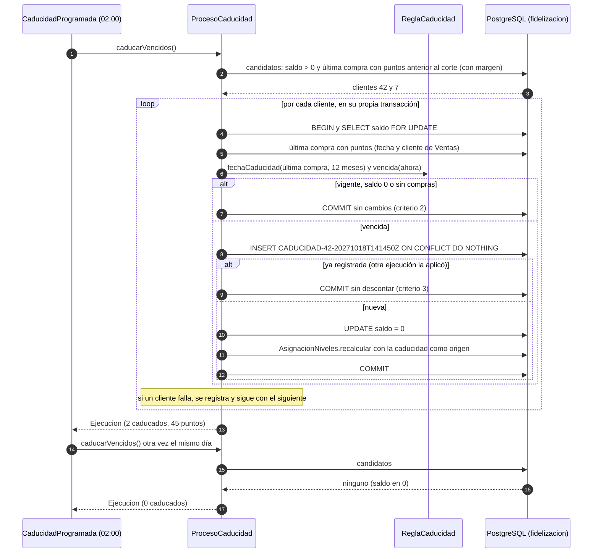

# Diagramas de la caducidad de puntos (SCRUM-602)

Diagrama de clases y diagramas de secuencia de SCRUM-50. La regla y los casos están en
`docs/fidelizacion/caducidad-puntos.md`. Están escritos en Mermaid: GitHub los dibuja al abrir este archivo, y
para adjuntarlos a la historia en Jira se exportan como imagen desde <https://mermaid.live>.

## Diagrama de clases

```mermaid
classDiagram
    direction LR

    class CaducidadProgramada {
        <<SCRUM-415>>
        +caducar()
    }
    class CaducidadController {
        +configuracion(req) Configuracion
        +ejecutar(req) Ejecucion
    }
    class ProcesoCaducidad {
        +caducarVencidos() Ejecucion
        +caducarSiVencio(clienteId, momento) Optional~Caducidad~
        +caducaronLosPuntosDe(idCompra) boolean
    }
    class ReglaCaducidad {
        <<SCRUM-418>>
        +fechaCaducidad(ultimaAcumulacion, vigenciaMeses) OffsetDateTime
        +vencida(fechaCaducidad, momento) boolean
        +idMovimiento(clienteId, fechaCaducidad) String
    }
    class VigenciaPuntos {
        <<SCRUM-416>>
        +meses() int
        +configuracion() Configuracion
    }
    class RegistroCaducidad {
        <<repository>>
        +candidatos(corte, vigenciaMeses) List~Long~
        +bloquearSaldo(clienteId) Optional~Long~
        +ultimaCompra(clienteId) Optional~UltimaCompra~
        +registrar(id, clienteId, idClienteOrigen, puntos, fecha) boolean
        +vaciarSaldo(clienteId)
        +caducaronLosPuntosDe(idCompra) boolean
    }
    class SaldoVigente {
        <<SCRUM-419>>
        +evaluar(clienteId, saldoRegistrado, momento) Estado
    }
    class Ejecucion {
        <<record>>
        +OffsetDateTime ejecutadoEn
        +int clientesRevisados
        +int clientesConPuntosCaducados
        +long puntosCaducados
        +int clientesConError
    }
    class ProcesadorMovimientos {
        +procesar(idEvento, contenido) long
    }
    class AsignacionNiveles {
        <<repository>>
        +recalcular(cliente, idTransaccion, tipo) Nivel
    }
    class ConsultaSaldoPuntos
    class ConsultaPuntosVentas
    class FidelizacionController

    CaducidadProgramada --> ProcesoCaducidad : cada día 02:00
    CaducidadController --> ProcesoCaducidad : ejecución manual
    CaducidadController --> VigenciaPuntos
    ProcesoCaducidad --> RegistroCaducidad : bloquea, registra CADUCIDAD y vacía el saldo
    ProcesoCaducidad --> ReglaCaducidad
    ProcesoCaducidad --> VigenciaPuntos
    ProcesoCaducidad --> AsignacionNiveles : nivel con la caducidad como origen
    ProcesoCaducidad ..> Ejecucion
    ProcesadorMovimientos --> ProcesoCaducidad : antes de cada movimiento
    SaldoVigente --> ReglaCaducidad
    SaldoVigente --> VigenciaPuntos
    ConsultaSaldoPuntos --> SaldoVigente
    ConsultaPuntosVentas --> SaldoVigente
    FidelizacionController --> SaldoVigente
```

## Diagrama de secuencia: proceso diario, dos veces el mismo día



## Diagrama de secuencia: un movimiento que llega con el saldo vencido

```mermaid
sequenceDiagram
    autonumber
    participant MV as Marketplace y Ventas
    participant F as ProcesadorMovimientos
    participant P as ProcesoCaducidad
    participant DB as PostgreSQL (fidelizacion)

    MV->>F: RIO-CRM-03 REDENCION R-7001 de 20 puntos (después del vencimiento)
    F->>DB: BEGIN
    F->>P: caducarSiVencio(42, fecha de la redención)
    P->>DB: SELECT saldo FOR UPDATE (35) y última compra
    P->>DB: INSERT CADUCIDAD y UPDATE saldo = 0
    P-->>F: 35 puntos caducaron el 2027-10-18
    F->>DB: reservar R-7001 y debitar 20
    DB-->>F: saldo insuficiente (0)
    F->>DB: ROLLBACK (no quedan ni la redención ni la caducidad)
    F->>DB: bitácora FALLIDO: "... saldo disponible es 0; 35 puntos caducaron el ..."
    Note over F,DB: el proceso diario registra la caducidad en su próxima ejecución

    MV->>F: RIO-CRM-03 ACUMULACION V-200 (después del vencimiento)
    F->>DB: BEGIN
    F->>P: caducarSiVencio(42, fecha de la compra)
    P->>DB: INSERT CADUCIDAD y UPDATE saldo = 0
    F->>DB: reservar V-200 y acreditar sus puntos
    F->>DB: nivel, bitácora PROCESADO y COMMIT
    Note over F,DB: solo quedan los puntos de V-200, con su nueva vigencia
```
