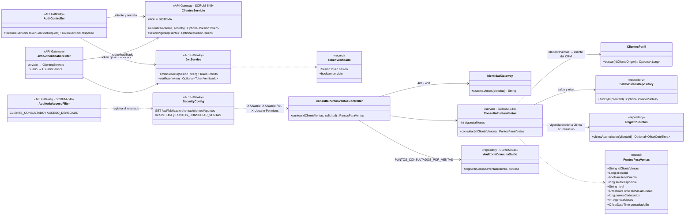
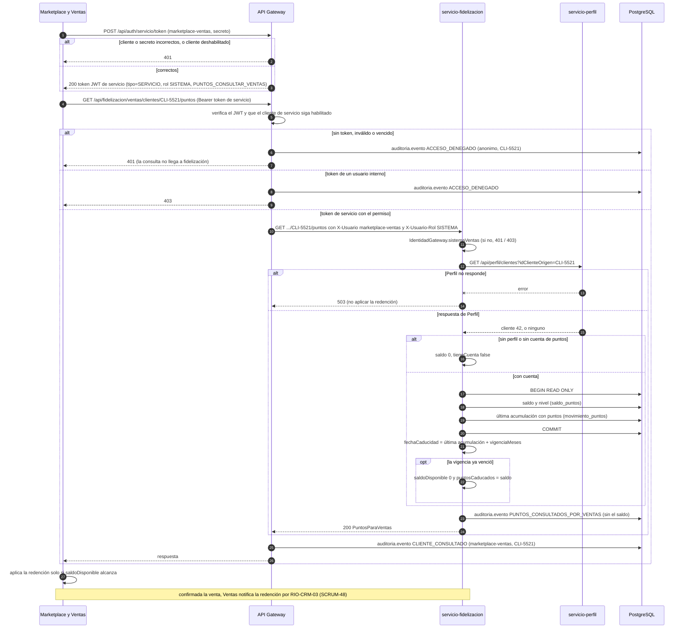

# Diagramas de la consulta de puntos por Marketplace y Ventas (SCRUM-601)

Diagrama de clases y diagrama de secuencia de SCRUM-525 (RIO-CRM-04). El contrato, la regla de caducidad y los
errores están en `docs/contratos-eventos/RIO-CRM-04-consulta-puntos.md`, y la especificación OpenAPI en
`docs/contratos-eventos/RIO-CRM-04-consulta-puntos.openapi.yaml`. Están escritos en Mermaid: GitHub los dibuja
al abrir este archivo, y para adjuntarlos a la historia en Jira se exportan como imagen desde
<https://mermaid.live>.

## Diagrama de clases

## Diagrama de secuencia: Ventas consulta los puntos antes de una redención

