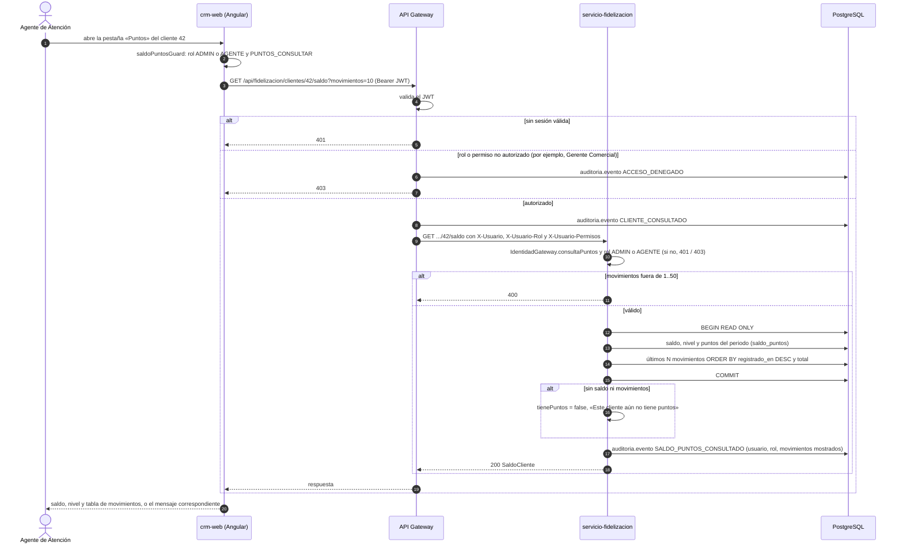

# Diagramas de la consulta del saldo de puntos (SCRUM-600)

Diagrama de clases y diagrama de secuencia de SCRUM-47. La consulta, la respuesta y los permisos están
en `docs/fidelizacion/consulta-saldo-puntos.md`. Están escritos en Mermaid: GitHub los dibuja al abrir
este archivo, y para adjuntarlos a la historia en Jira se exportan como imagen desde <https://mermaid.live>.

## Diagrama de clases

```mermaid
classDiagram
    direction LR

    class SaldoPuntosComponent {
        <<Angular>>
        +clienteId
        +saldo
        +error
        +cargar()
    }
    class SaldoPuntosService {
        <<Angular>>
        +consultar(clienteId, movimientos) Observable~SaldoCliente~
    }
    class AuthService {
        <<Angular>>
        +puedeConsultarSaldoPuntos() boolean
    }
    class SecurityConfig {
        <<API Gateway>>
        GET /api/fidelizacion/clientes/*/saldo
        rol ADMINISTRADOR_CRM o AGENTE_ATENCION
        y permiso PUNTOS_CONSULTAR
    }
    class ConsultaSaldoController {
        +saldo(clienteId, movimientos, solicitud) SaldoCliente
    }
    class IdentidadGateway {
        +consultaPuntos(solicitud) Identidad
    }
    class Identidad {
        <<record>>
        +String usuario
        +String rol
    }
    class ConsultaSaldoPuntos {
        <<service>>
        +consultar(clienteId, movimientos) SaldoCliente
    }
    class SaldoCliente {
        <<record>>
        +long clienteId
        +boolean tienePuntos
        +String mensaje
        +long saldo
        +String nivel
        +long puntosPeriodo
        +long totalMovimientos
        +List~MovimientoReciente~ ultimosMovimientos
    }
    class MovimientoReciente {
        <<record>>
        +String idTransaccion
        +String tipoMovimiento
        +long puntos
        +long variacionSaldo
        +long saldoResultante
        +String idTransaccionRevertida
    }
    class SaldoPuntosRepository {
        <<repository>>
        +findById(clienteId) Optional~SaldoPuntos~
    }
    class RegistroPuntos {
        <<repository>>
        +ultimosMovimientos(clienteId, limite) List~DetalleMovimiento~
        +contarMovimientos(clienteId) long
    }
    class AuditoriaConsultaSaldo {
        <<SCRUM-401>>
        +registrar(usuario, rol, saldo)
    }

    SaldoPuntosComponent --> SaldoPuntosService
    SaldoPuntosComponent ..> AuthService : pestaña y guard
    SaldoPuntosService ..> SecurityConfig : HTTP con el token
    SecurityConfig ..> ConsultaSaldoController : X-Usuario, X-Usuario-Rol, X-Usuario-Permisos
    ConsultaSaldoController --> IdentidadGateway : 401 / 403
    IdentidadGateway ..> Identidad
    ConsultaSaldoController --> ConsultaSaldoPuntos
    ConsultaSaldoController --> AuditoriaConsultaSaldo : auditoria.evento
    ConsultaSaldoPuntos --> SaldoPuntosRepository : saldo y nivel
    ConsultaSaldoPuntos --> RegistroPuntos : últimos movimientos
    ConsultaSaldoPuntos ..> SaldoCliente
    SaldoCliente *-- MovimientoReciente
```

## Diagrama de secuencia: el Agente consulta el saldo de un cliente

