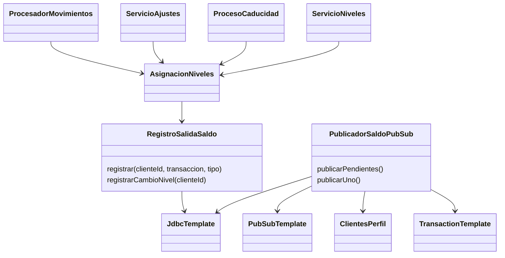

# SCRUM-623 · Diagramas de publicación del saldo de puntos

## Clases



## Secuencia: movimiento confirmado y reintento

```mermaid
sequenceDiagram
    participant M as Movimiento / ajuste / caducidad
    participant N as AsignacionNiveles
    participant B as PostgreSQL
    participant D as PublicadorSaldoPubSub
    participant P as Perfil
    participant G as Google Cloud Pub/Sub
    participant V as Marketplace y Ventas
    M->>B: BEGIN; reservar movimiento y actualizar saldo
    M->>N: recalcular(cliente, transaccion, tipo)
    N->>B: actualizar nivel; insertar instantanea en salida
    M->>B: COMMIT movimiento + saldo + nivel + evento
    Note over M,B: Un rechazo, duplicado o rollback no deja salida
    loop Ejecucion programada, una transaccion por fila
        D->>B: SELECT pendiente FOR UPDATE SKIP LOCKED
        Note over D,B: Solo el primer pendiente por cliente
        opt Falta identificador de Marketplace
            D->>P: consultar perfil
            P-->>D: identificador unico o error
            D->>B: persistir identificador resuelto
        end
        D->>G: publish JSON; ruta=puntos.saldo.actualizado
        alt Confirmado por Pub/Sub
            G-->>D: messageId
            D->>B: marcar publicado; COMMIT
            G-->>V: entrega asincrona
            Note over G,V: Deduplicar idEvento y comparar secuencia
        else Error / timeout
            D->>B: intentos + 1, error, proximo intento; COMMIT
            Note over D,G: Reintentar con el mismo idEvento
        end
    end
```

Un cambio de nivel por recálculo general usa el mismo circuito, con `RECALCULO_NIVEL` y
sin transacción de Marketplace. Si se cae el proceso después del envío y antes del commit del
despachador, el evento queda pendiente y puede reentregarse: la garantía es al menos una vez.
