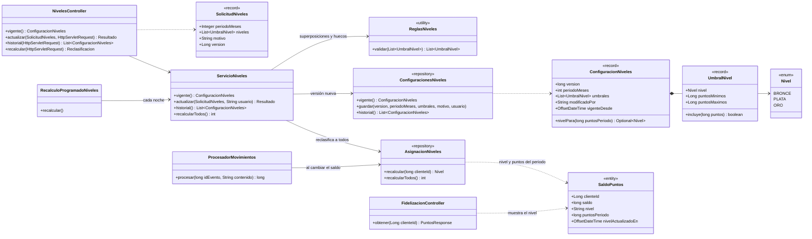
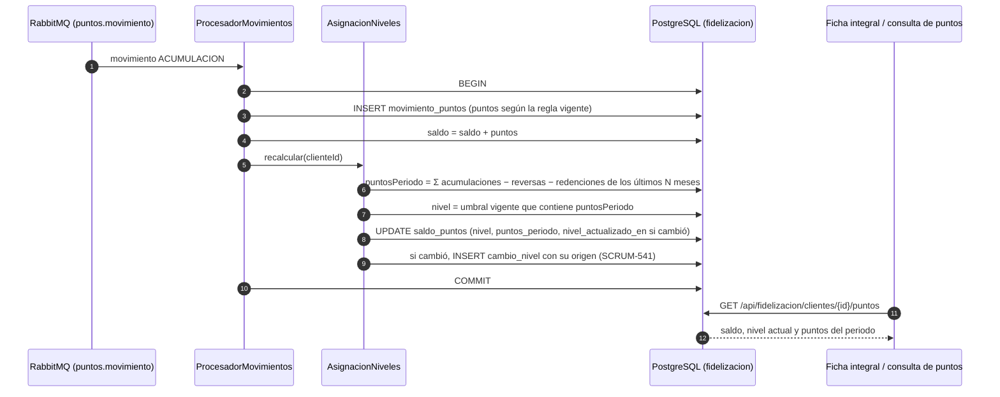
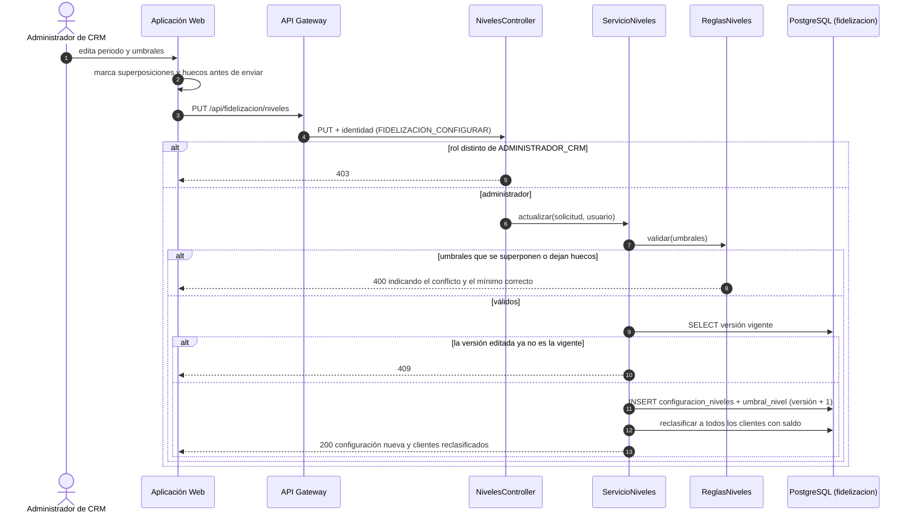

# Diagramas de los niveles de fidelización (SCRUM-597)

Diagrama de clases y diagramas de secuencia de SCRUM-49. Las reglas y umbrales están en
`docs/fidelizacion/niveles-fidelizacion.md`. Están escritos en Mermaid: GitHub los dibuja al abrir este
archivo, y para adjuntarlos a la historia en Jira se exportan como imagen desde <https://mermaid.live>.

## Diagrama de clases

## Diagrama de secuencia: el nivel sigue al saldo

## Diagrama de secuencia: el administrador cambia los umbrales

