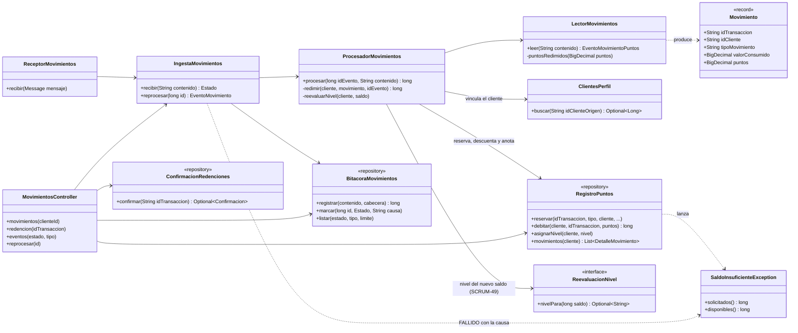
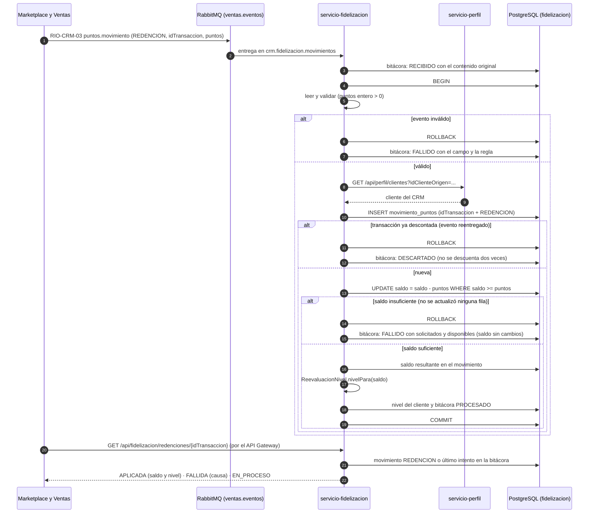

# Diagramas de la redención de puntos (SCRUM-598)

Diagrama de clases y diagrama de secuencia de la integración asíncrona de SCRUM-48. La lógica está en
`docs/fidelizacion/redencion-puntos.md` y el contrato en
`docs/contratos-eventos/RIO-CRM-03-movimiento-puntos.md`. Están escritos en Mermaid: GitHub los dibuja
al abrir este archivo, y para adjuntarlos a la historia en Jira se exportan como imagen desde
<https://mermaid.live>.

## Diagrama de clases

## Diagrama de secuencia: redención, saldo insuficiente, reentrega y confirmación

