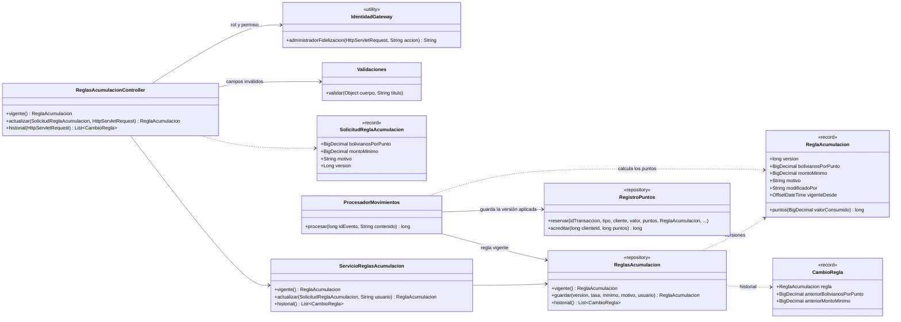

# Diagramas de las reglas de acumulación de puntos (SCRUM-596)

Diagrama de clases y diagrama de secuencia de SCRUM-46. La lógica está en
`docs/fidelizacion/reglas-acumulacion.md`. Están escritos en Mermaid: GitHub los dibuja al abrir este
archivo, y para adjuntarlos a la historia en Jira se exportan como imagen desde <https://mermaid.live>.

## Diagrama de clases



## Diagrama de secuencia: cambiar la regla y aplicarla a la compra siguiente

```mermaid
sequenceDiagram
    autonumber
    actor A as Administrador de CRM
    participant W as Aplicación Web
    participant G as API Gateway
    participant C as ReglasAcumulacionController
    participant S as ServicioReglasAcumulacion
    participant DB as PostgreSQL (fidelizacion)
    participant P as ProcesadorMovimientos

    A->>W: edita tasa y monto mínimo, Guardar
    W->>G: PUT /api/fidelizacion/reglas/acumulacion {tasa, mínimo, motivo, version}
    alt sin FIDELIZACION_CONFIGURAR
        G-->>W: 403
    else con permiso
        G->>C: PUT + X-Usuario, X-Usuario-Rol, X-Usuario-Permisos
        alt rol distinto de ADMINISTRADOR_CRM
            C-->>W: 403 acceso denegado
        else valores vacíos, negativos o con más de 2 decimales
            C-->>W: 400 con el campo inválido
        else válida
            C->>S: actualizar(solicitud, usuario)
            S->>DB: SELECT versión vigente
            alt la versión editada ya no es la vigente
                S-->>W: 409 la regla cambió
            else misma tasa y mismo mínimo
                S-->>W: 400 la regla no cambió
            else
                S->>DB: INSERT regla_acumulacion (versión + 1, usuario, fecha)
                S-->>W: 200 regla nueva
            end
        end
    end

    Note over P,DB: Movimiento RIO-CRM-03 siguiente
    P->>DB: SELECT regla vigente
    P->>P: puntos = 0 si valor < mínimo; si no, parte entera(valor / tasa)
    P->>DB: INSERT movimiento_puntos (puntos, tasa, mínimo, version_regla)
    P->>DB: saldo = saldo + puntos
    Note over DB: Los movimientos anteriores conservan sus puntos y su versión de regla
```
