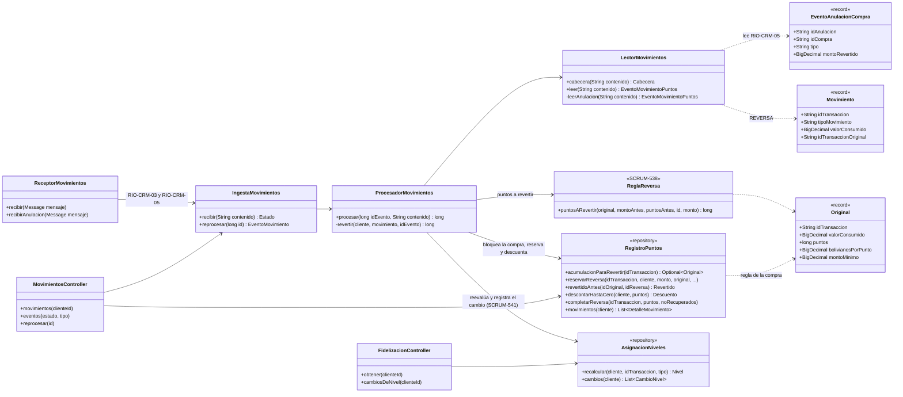
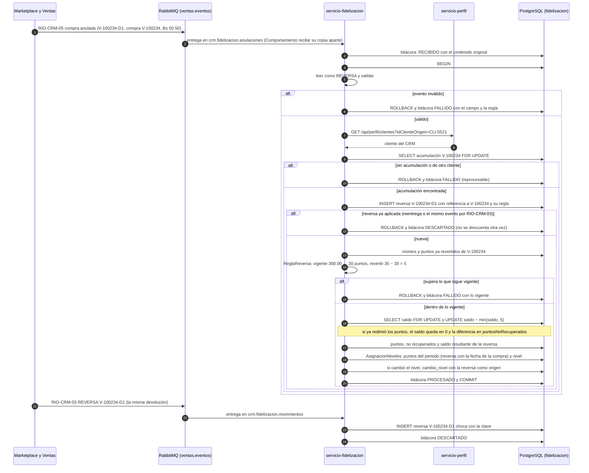

# Diagramas de la reversa de puntos (SCRUM-599)

Diagrama de clases y diagrama de secuencia de la integración asíncrona de SCRUM-524. La regla y los
casos están en `docs/fidelizacion/reversa-puntos.md`, y los contratos en
`docs/contratos-eventos/RIO-CRM-03-movimiento-puntos.md` y `docs/contratos-eventos/RIO-CRM-05-anulacion-compra.md`.
Están escritos en Mermaid: GitHub los dibuja al abrir este archivo, y para adjuntarlos a la historia en
Jira se exportan como imagen desde <https://mermaid.live>.

## Diagrama de clases

## Diagrama de secuencia: devolución parcial, reentrega por el otro evento, saldo insuficiente y nivel

