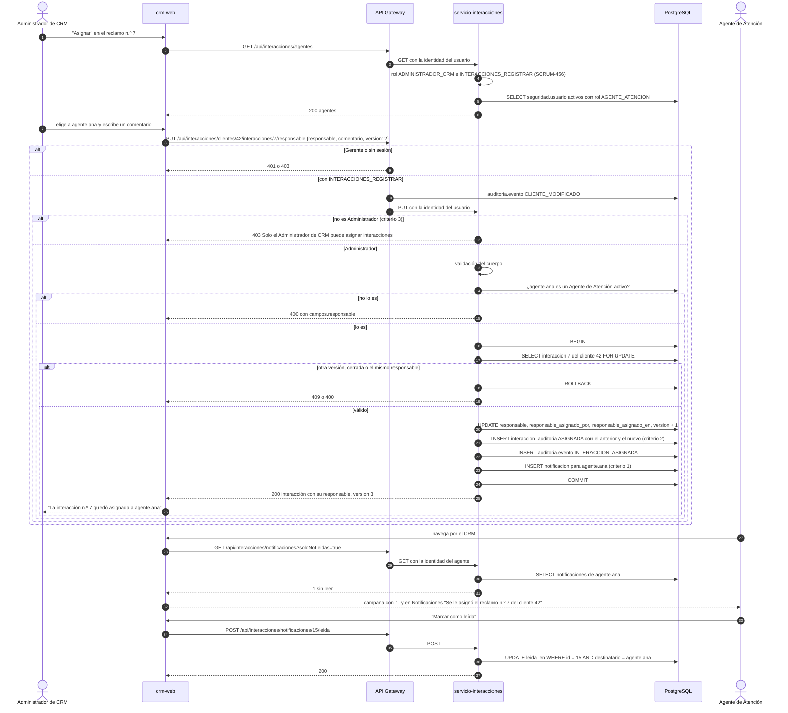

# Diagramas de la asignación de interacciones (SCRUM-608)

Diagrama de clases y de secuencia de SCRUM-56. El flujo, las reglas, la API y las notificaciones están en
`docs/interacciones/asignacion-interacciones.md`. Están escritos en Mermaid: GitHub los dibuja al abrir este
archivo, y para adjuntarlos a la historia en Jira se exportan como imagen desde <https://mermaid.live>.

## Diagrama de clases

```mermaid
classDiagram
    direction LR

    class InteraccionesClienteComponent {
        <<Angular>>
        +soloMias boolean
        +asignada(interaccion)
    }
    class AsignacionInteraccionComponent {
        <<Angular, SCRUM-455>>
        +interaccion
        +agente
        +comentario
        +abrir()
        +guardar()
    }
    class NotificacionesComponent {
        <<Angular, SCRUM-455>>
        +cargar()
        +marcar(notificacion)
    }
    class LayoutComponent {
        <<Angular>>
        campana con las no leídas
    }
    class InteraccionesService {
        <<Angular>>
        +agentes()
        +asignar(clienteId, id, responsable, comentario, version)
        +notificaciones(soloNoLeidas)
        +marcarLeida(id)
    }
    class SecurityConfig {
        <<API Gateway>>
        GET: INTERACCIONES_CONSULTAR
        PUT y POST: INTERACCIONES_REGISTRAR
    }
    class AgentesController {
        <<SCRUM-457>>
        +activos(req) List~Agente~
    }
    class InteraccionesController {
        +asignar(clienteId, id, solicitud, req) Interaccion
        +historial(clienteId, ..., responsable, req) PaginaInteracciones
    }
    class NotificacionesController {
        <<SCRUM-459>>
        +consultar(soloNoLeidas, req) Bandeja
        +marcarLeida(id, req) Notificacion
    }
    class IdentidadGateway {
        <<SCRUM-456>>
        +asignacion(req) Identidad
        +consulta(req) Identidad
    }
    class SolicitudAsignacion {
        <<record>>
        +String responsable
        +String comentario
        +Long version
    }
    class ServicioInteracciones {
        <<SCRUM-457>>
        +asignar(clienteId, id, solicitud, identidad) Interaccion
    }
    class AgentesAtencion {
        <<repository, lee seguridad.usuario>>
        +activos() List~Agente~
        +activo(usuario) Optional~Agente~
    }
    class RegistroInteracciones {
        <<repository>>
        +bloquear(clienteId, id) Optional~Interaccion~
        +asignar(id, responsable, usuario) Interaccion
    }
    class AuditoriaInteracciones {
        <<repository, SCRUM-458>>
        +asignada(interaccion, usuario, rol, anterior, nuevo, comentario)
    }
    class NotificacionesUsuario {
        <<repository, SCRUM-459>>
        +crear(destinatario, tipo, interaccionId, clienteId, mensaje, comentario, creadaPor) Notificacion
        +de(destinatario, soloNoLeidas, limite) List~Notificacion~
        +marcarLeida(id, destinatario) Optional~Notificacion~
    }
    class Interaccion {
        <<record>>
        +String estado
        +long version
        +String responsable
        +String responsableAsignadoPor
        +OffsetDateTime responsableAsignadoEn
    }
    class Notificacion {
        <<record>>
        +String tipo
        +long interaccionId
        +long clienteId
        +String mensaje
        +String comentario
        +OffsetDateTime leidaEn
    }

    InteraccionesClienteComponent --> AsignacionInteraccionComponent : una por interacción
    AsignacionInteraccionComponent --> InteraccionesService
    NotificacionesComponent --> InteraccionesService
    LayoutComponent --> InteraccionesService
    InteraccionesService ..> SecurityConfig : HTTP con el token
    SecurityConfig ..> AgentesController : X-Usuario, X-Usuario-Rol, X-Usuario-Permisos
    SecurityConfig ..> InteraccionesController
    SecurityConfig ..> NotificacionesController
    AgentesController ..> IdentidadGateway
    InteraccionesController ..> IdentidadGateway
    NotificacionesController ..> IdentidadGateway
    AgentesController --> AgentesAtencion
    InteraccionesController ..> SolicitudAsignacion
    InteraccionesController --> ServicioInteracciones
    NotificacionesController --> NotificacionesUsuario
    ServicioInteracciones --> AgentesAtencion
    ServicioInteracciones --> RegistroInteracciones
    ServicioInteracciones --> AuditoriaInteracciones : ASIGNADA e INTERACCION_ASIGNADA
    ServicioInteracciones --> NotificacionesUsuario : INTERACCION_ASIGNADA
    RegistroInteracciones ..> Interaccion
    NotificacionesUsuario ..> Notificacion
```

## Diagrama de secuencia: asignar una interacción y notificar al agente

