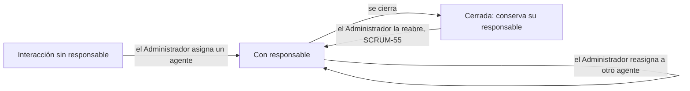

# Asignación de una interacción a un agente responsable (SCRUM-56)

El Administrador de CRM asigna cada interacción a un agente responsable para que cada caso tenga quien lo atienda
(RF-48, EPIC-09). Se apoya en el registro (SCRUM-52) y el seguimiento (SCRUM-55) de interacciones. Diagramas en
`docs/interacciones/asignacion-interacciones-diagramas.md`.

## Flujo de asignación (SCRUM-454)



1. **Toda interacción nueva empieza sin responsable**, también las registradas antes de esta historia. Registrarla
   no la asigna: la atiende quien la tome hasta que el Administrador la asigne.
2. **El Administrador elige el agente** de la lista de agentes activos y, si quiere, escribe un comentario para él.
3. **El servicio guarda el responsable**, con quién lo asignó y cuándo, sube la versión y, en la misma transacción:
   - deja el cambio en el historial de la interacción, con el responsable anterior y el nuevo (criterio de
     aceptación 2);
   - crea la notificación para el agente (criterio de aceptación 1).
4. **El agente ve la notificación** en el CRM y la marca como leída. En el historial del cliente filtra las
   interacciones de las que es responsable.

### Reglas

| Regla | Si no se cumple |
|---|---|
| Solo el **Administrador de CRM** asigna o reasigna (criterio de aceptación 3) | `403` "Solo el Administrador de CRM puede asignar interacciones" |
| El responsable es un usuario **activo** con el rol **Agente de Atención** | `400` con `campos.responsable` |
| La interacción **no está cerrada**: una cerrada es constancia del caso (SCRUM-453) | `409` "La interacción está cerrada: reábrala para modificarla" |
| El responsable es **distinto del actual** | `400` "La interacción ya tiene ese responsable" |
| La `version` es la que el usuario tenía en pantalla | `409` con `campos.version` |

- **No se quita el responsable:** una interacción asignada siempre tiene responsable. Si el agente deja de
  atenderla, el Administrador la reasigna a otro.
- **El Agente de Atención** ve quién es el responsable de cada interacción, pero no la asigna ni la reasigna, ni
  siquiera a sí mismo. El seguimiento (estado y tipo) lo sigue actualizando cualquier agente (SCRUM-55).
- **El Gerente Comercial** ve el responsable y no lo cambia: el Gateway le responde `403`, porque no tiene
  `INTERACCIONES_REGISTRAR`.
- **El comentario** es opcional, de hasta 500 caracteres. Queda en el historial y en la notificación.

### Quién es agente

Los usuarios internos los administra el API Gateway (`seguridad.usuario`, SCRUM-506). `servicio-interacciones` los
lee en modo de solo lectura, de la misma base, para listar los agentes y comprobar el responsable. No los copia: un
agente desactivado deja de aparecer en la lista en el momento.

## API

### Agentes para elegir

```
GET /api/interacciones/agentes
```

Solo el Administrador de CRM. Devuelve los agentes activos ordenados por nombre:
`[{ "usuario": "agente.ana", "nombreCompleto": "Ana Rojas" }]`. No es una ruta de cliente, así que el Gateway no la
audita como acceso a clientes (`docs/seguridad/convencion-rutas-clientes.md`).

### Asignar o reasignar (SCRUM-457)

```
PUT /api/interacciones/clientes/{clienteId}/interacciones/{id}/responsable
```

```json
{ "responsable": "agente.ana", "comentario": "Cliente frecuente: priorizar", "version": 3 }
```

Responde la interacción con `responsable`, `responsableAsignadoPor`, `responsableAsignadoEn` y la versión nueva. El
Gateway registra `CLIENTE_MODIFICADO`, porque la ruta es de cliente.

### Historial del cambio de responsable (SCRUM-458)

Cada asignación y reasignación queda:

- En `interacciones.interaccion_auditoria`: operación `ASIGNADA`, el usuario que la hizo, su rol, la fecha,
  `cambios.responsable` con el anterior y el nuevo, y el comentario.
- En la auditoría compartida: `INTERACCION_ASIGNADA`, con la entidad `CLIENTE`, el responsable anterior y el nuevo.

La consulta la auditoría de la interacción (`GET …/interacciones/{id}/auditoria`, Administrador con
`AUDITORIA_CONSULTAR`).

### Filtro por responsable

El historial (`GET …/interacciones`) suma el filtro `responsable`, por ejemplo `?responsable=agente.ana&estado=ABIERTA`.

### Notificaciones del agente (SCRUM-459)

| Método | Ruta | Qué hace |
|---|---|---|
| GET | `/api/interacciones/notificaciones?soloNoLeidas=true` | Las notificaciones del usuario de la sesión, de la más reciente a la más antigua (hasta 50) |
| POST | `/api/interacciones/notificaciones/{id}/leida` | Marca como leída una notificación propia |

- Una notificación dice qué interacción se le asignó, de qué cliente, quién la asignó y el comentario.
- Cada usuario ve **solo las suyas**. Marcar la de otro responde `404`.
- Si la asignación no se guarda, tampoco queda la notificación: se guardan en la misma transacción.
