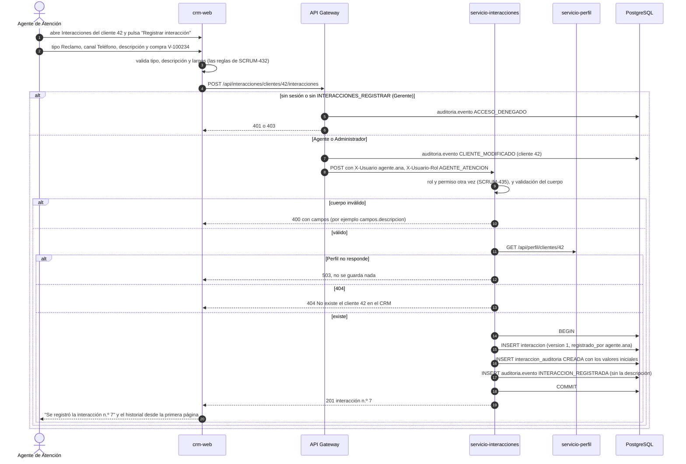
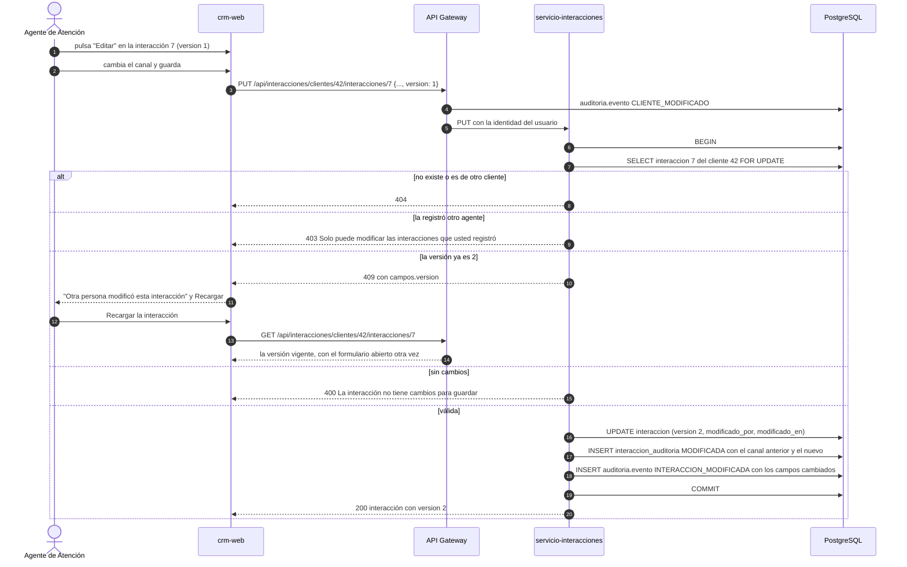
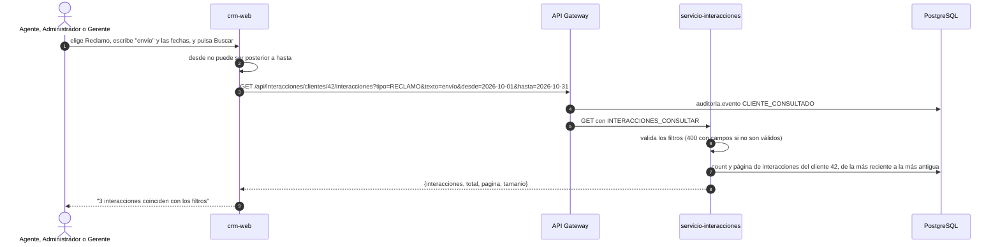

# Diagramas del registro de interacciones (SCRUM-604)

Diagrama de clases y de secuencia de SCRUM-52. El modelo de datos, los permisos y las reglas están en
`docs/interacciones/registro-interacciones.md`. Están escritos en Mermaid: GitHub los dibuja al abrir este archivo,
y para adjuntarlos a la historia en Jira se exportan como imagen desde <https://mermaid.live>.

## Diagrama de clases

```mermaid
classDiagram
    direction LR

    class InteraccionesClienteComponent {
        <<Angular, SCRUM-430 y SCRUM-431>>
        +borrador FiltroInteracciones
        +cargar(pagina)
        +buscar()
        +limpiar()
        +recargar(id)
    }
    class FormularioInteraccionComponent {
        <<Angular, SCRUM-434>>
        +clienteId
        +interaccion
        +guardar()
    }
    class InteraccionesService {
        <<Angular>>
        +historial(clienteId, filtro, pagina, tamanio)
        +detalle(clienteId, id)
        +registrar(clienteId, datos)
        +modificar(clienteId, id, datos, version)
    }
    class SecurityConfig {
        <<API Gateway>>
        GET: INTERACCIONES_CONSULTAR
        POST y PUT: INTERACCIONES_REGISTRAR
    }
    class AuditoriaAccesoFilter {
        <<API Gateway>>
        CLIENTE_CONSULTADO, CLIENTE_MODIFICADO, ACCESO_DENEGADO
    }
    class InteraccionesController {
        <<SCRUM-432>>
        +registrar(clienteId, solicitud, req) Interaccion
        +modificar(clienteId, id, solicitud, req) Interaccion
        +detalle(clienteId, id, req) Interaccion
        +historial(clienteId, filtros, req) PaginaInteracciones
        +auditoria(clienteId, id, req) List~RegistroAuditoria~
    }
    class IdentidadGateway {
        <<SCRUM-435>>
        +consulta(req) Identidad
        +registro(req) Identidad
        +auditoria(req) Identidad
    }
    class SolicitudInteraccion {
        <<record>>
        +String tipo
        +String canal
        +String asunto
        +String descripcion
        +String referenciaCompra
    }
    class SolicitudCambio {
        <<record>>
        +String tipo
        +String canal
        +String asunto
        +String descripcion
        +String referenciaCompra
        +Long version
    }
    class ServicioInteracciones {
        <<SCRUM-432>>
        +registrar(clienteId, solicitud, identidad) Interaccion
        +modificar(clienteId, id, solicitud, identidad) Interaccion
        +detalle(clienteId, id) Interaccion
        +historial(clienteId, filtros) PaginaInteracciones
        +auditoria(clienteId, id) List~RegistroAuditoria~
    }
    class ClientesPerfil {
        <<cliente HTTP>>
        +existe(clienteId) boolean
    }
    class RegistroInteracciones {
        <<repository>>
        +registrar(clienteId, campos, usuario, rol) Interaccion
        +buscar(clienteId, id) Optional~Interaccion~
        +bloquear(clienteId, id) Optional~Interaccion~
        +modificar(id, campos, usuario) Interaccion
        +historial(clienteId, filtro) PaginaInteracciones
    }
    class AuditoriaInteracciones {
        <<repository, SCRUM-436>>
        +creada(interaccion)
        +modificada(interaccion, rol, cambios)
        +de(interaccionId) List~RegistroAuditoria~
    }
    class Interaccion {
        <<record, SCRUM-433>>
        +long id
        +long clienteId
        +String tipo
        +String canal
        +String asunto
        +String descripcion
        +String referenciaCompra
        +String registradoPor
        +OffsetDateTime registradoEn
        +String modificadoPor
        +long version
    }

    InteraccionesClienteComponent --> FormularioInteraccionComponent : registrar y editar
    InteraccionesClienteComponent --> InteraccionesService
    FormularioInteraccionComponent --> InteraccionesService
    InteraccionesService ..> SecurityConfig : HTTP con el token
    SecurityConfig ..> AuditoriaAccesoFilter
    SecurityConfig ..> InteraccionesController : X-Usuario, X-Usuario-Rol, X-Usuario-Permisos
    InteraccionesController --> IdentidadGateway : acceso antes del cuerpo
    InteraccionesController ..> SolicitudInteraccion
    InteraccionesController ..> SolicitudCambio
    InteraccionesController --> ServicioInteracciones
    ServicioInteracciones --> ClientesPerfil : el cliente existe
    ServicioInteracciones --> RegistroInteracciones : interacciones.interaccion
    ServicioInteracciones --> AuditoriaInteracciones : interaccion_auditoria y auditoria.evento
    RegistroInteracciones ..> Interaccion
```

## Diagrama de secuencia: registrar una interacción

## Diagrama de secuencia: corregir una interacción

## Diagrama de secuencia: consultar y filtrar el historial

