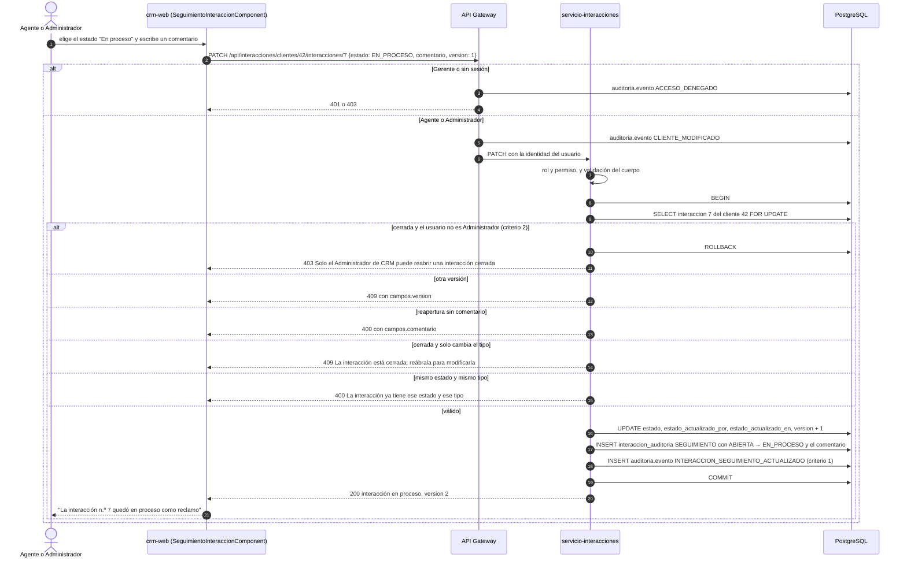
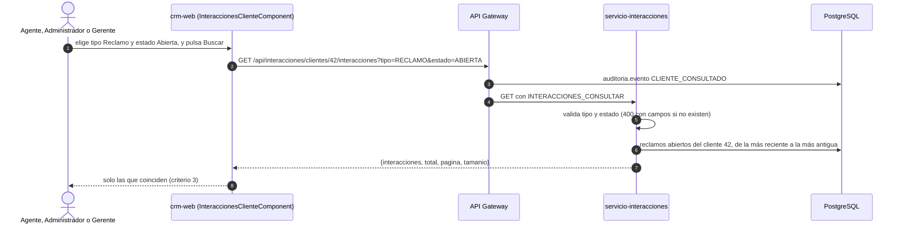

# Diagramas de la clasificación y el seguimiento de interacciones (SCRUM-605)

Diagrama de clases y de secuencia de SCRUM-55. El catálogo de tipos y estados, las transiciones y las reglas
están en `docs/interacciones/seguimiento-interacciones.md`. Están escritos en Mermaid: GitHub los dibuja al abrir
este archivo, y para adjuntarlos a la historia en Jira se exportan como imagen desde <https://mermaid.live>.

## Diagrama de clases

```mermaid
classDiagram
    direction LR

    class InteraccionesClienteComponent {
        <<Angular, SCRUM-450>>
        +borrador FiltroInteracciones
        +buscar()
        +seguimientoActualizado(interaccion)
    }
    class SeguimientoInteraccionComponent {
        <<Angular, SCRUM-450>>
        +interaccion
        +estado
        +tipo
        +comentario
        +guardar()
    }
    class InteraccionesService {
        <<Angular>>
        +historial(clienteId, filtro, pagina, tamanio)
        +seguimiento(clienteId, id, cambio, version)
    }
    class SecurityConfig {
        <<API Gateway>>
        PATCH: INTERACCIONES_REGISTRAR
    }
    class InteraccionesController {
        <<SCRUM-452>>
        +seguimiento(clienteId, id, solicitud, req) Interaccion
        +historial(clienteId, tipo, estado, ...) PaginaInteracciones
    }
    class SolicitudSeguimiento {
        <<record, SCRUM-452>>
        +String estado
        +String tipo
        +String comentario
        +Long version
    }
    class ServicioInteracciones {
        <<SCRUM-452 y SCRUM-453>>
        +seguimiento(clienteId, id, solicitud, identidad) Interaccion
        +modificar(clienteId, id, solicitud, identidad) Interaccion
        -exigirNoCerrada(interaccion)
        -verificarVersion(interaccion, version)
    }
    class RegistroInteracciones {
        <<repository>>
        +bloquear(clienteId, id) Optional~Interaccion~
        +actualizarSeguimiento(id, tipo, estado, cambiaEstado, usuario) Interaccion
        +historial(clienteId, filtro) PaginaInteracciones
    }
    class AuditoriaInteracciones {
        <<repository>>
        +seguimiento(interaccion, usuario, rol, cambios, comentario)
    }
    class EstadoInteraccion {
        <<enumeration, SCRUM-451>>
        ABIERTA
        EN_PROCESO
        CERRADA
    }
    class TipoInteraccion {
        <<enumeration>>
        CONSULTA
        RECLAMO
        NOTA
    }
    class Interaccion {
        <<record, SCRUM-449>>
        +String tipo
        +String estado
        +String estadoActualizadoPor
        +OffsetDateTime estadoActualizadoEn
        +long version
        +cerrada() boolean
    }

    InteraccionesClienteComponent --> SeguimientoInteraccionComponent : una por interacción
    InteraccionesClienteComponent --> InteraccionesService
    SeguimientoInteraccionComponent --> InteraccionesService
    InteraccionesService ..> SecurityConfig : HTTP con el token
    SecurityConfig ..> InteraccionesController : X-Usuario, X-Usuario-Rol, X-Usuario-Permisos
    InteraccionesController ..> SolicitudSeguimiento
    InteraccionesController --> ServicioInteracciones
    ServicioInteracciones --> RegistroInteracciones
    ServicioInteracciones --> AuditoriaInteracciones : SEGUIMIENTO e INTERACCION_SEGUIMIENTO_ACTUALIZADO
    Interaccion ..> EstadoInteraccion
    Interaccion ..> TipoInteraccion
    RegistroInteracciones ..> Interaccion
```

## Diagrama de secuencia: cambiar el estado o reabrir una interacción

## Diagrama de secuencia: filtrar por tipo y estado

