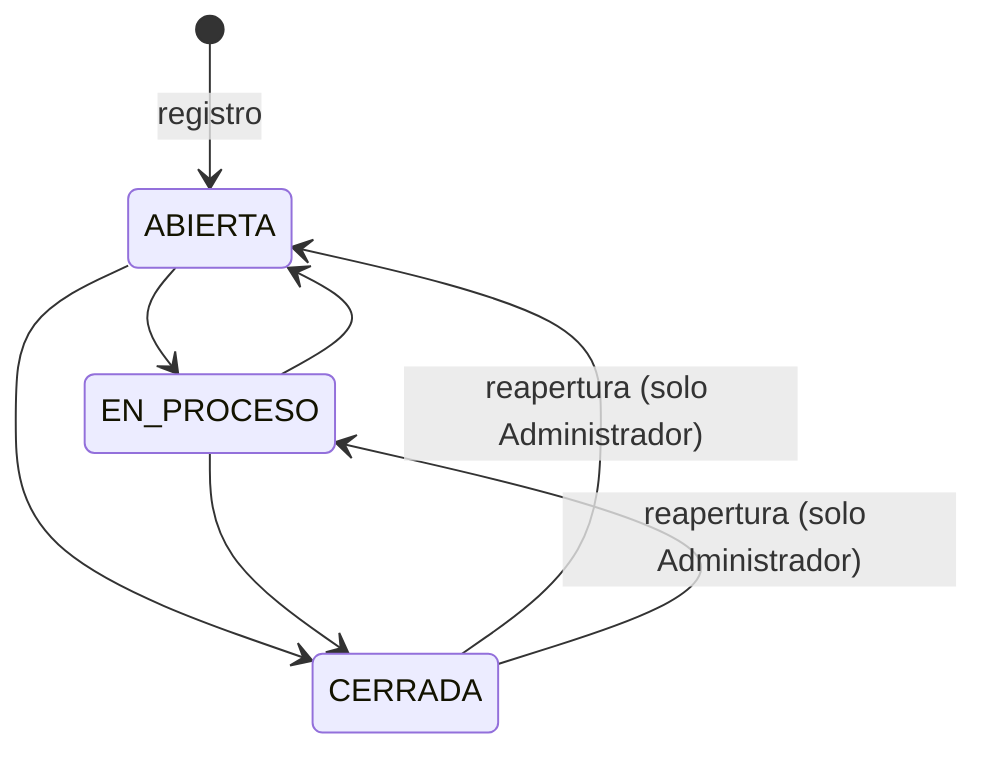

# Clasificación y seguimiento de interacciones (SCRUM-55)

El Agente de Atención al Cliente clasifica cada interacción por tipo y actualiza su estado de seguimiento
(abierta, en proceso o cerrada) para dar seguimiento a cada caso (RF-47, EPIC-09). Se apoya en el registro de
interacciones (SCRUM-52, `docs/interacciones/registro-interacciones.md`). Diagramas en
`docs/interacciones/seguimiento-interacciones-diagramas.md`.

## Catálogo de tipos y estados (SCRUM-451)

### Tipos de interacción

Son los de SCRUM-433. Una interacción se puede **reclasificar** mientras no esté cerrada, por ejemplo una consulta
que en realidad era un reclamo.

| Código | Nombre | Cuándo se usa |
|---|---|---|
| `CONSULTA` | Consulta | El cliente pide información |
| `RECLAMO` | Reclamo | El cliente expresa una queja o un problema |
| `NOTA` | Nota | Observación interna del agente sobre la atención |

### Estados de seguimiento

Toda interacción nueva empieza **abierta**, también las registradas antes de esta historia.

| Código | Nombre | Significado |
|---|---|---|
| `ABIERTA` | Abierta | Registrada y pendiente de atención |
| `EN_PROCESO` | En proceso | Un agente la está atendiendo |
| `CERRADA` | Cerrada | El caso se resolvió o no requiere más acciones |

### Transiciones



| Desde | Hacia | Quién | Comentario |
|---|---|---|---|
| `ABIERTA` | `EN_PROCESO` o `CERRADA` | Agente o Administrador | Opcional; al cerrar se recomienda indicar cómo se resolvió |
| `EN_PROCESO` | `ABIERTA` o `CERRADA` | Agente o Administrador | Opcional |
| `CERRADA` | `ABIERTA` o `EN_PROCESO` | **Solo el Administrador de CRM** (reapertura) | **Obligatorio**, de 10 a 500 caracteres: por qué se reabre |

- Pasar al mismo estado en que ya está no es un cambio y se rechaza con `400`.
- El Gerente Comercial solo consulta el estado. No lo cambia: el Gateway le responde `403`, porque no tiene
  `INTERACCIONES_REGISTRAR`.

### Reglas de la interacción cerrada

Una interacción cerrada queda como constancia del caso:

- **No se modifica:** ni su contenido (`PUT`) ni su tipo. Responde `409` "La interacción está cerrada: reábrala
  para modificarla".
- **Para corregirla,** el Administrador la reabre, con un comentario, y después se modifica.

### Quién da seguimiento

El **seguimiento**, es decir el estado y el tipo, lo actualiza **cualquier Agente de Atención o el Administrador**,
aunque no la haya registrado: un caso pasa de un agente a otro durante la atención. La **corrección del
contenido** (`PUT`, SCRUM-435) sigue limitada a quien la registró o al Administrador. La asignación de un
responsable queda para SCRUM-56.

## API (SCRUM-452)

```
PATCH /api/interacciones/clientes/{clienteId}/interacciones/{id}
```

```json
{ "estado": "EN_PROCESO", "tipo": "RECLAMO", "comentario": "Se pidió a Ventas el producto faltante", "version": 3 }
```

| Campo | Regla |
|---|---|
| `estado` | Opcional: `ABIERTA`, `EN_PROCESO` o `CERRADA` |
| `tipo` | Opcional: `CONSULTA`, `RECLAMO` o `NOTA` |
| `comentario` | Opcional, hasta 500 caracteres |
| `version` | Obligatoria: la versión que el usuario tenía en pantalla |

- **Qué se envía:** al menos el estado o el tipo. Lo que no se envía no cambia.
- **Rechazos:**
  - Si no cambia nada, responde `400`.
  - Si otra persona la cambió antes, `409` con `campos.version`.
  - Una interacción de otro cliente responde `404`.
- **Si el estado cambia:** la interacción guarda quién lo cambió y cuándo (`estadoActualizadoPor`,
  `estadoActualizadoEn`).
- **Versión:** cada cambio la sube.
- **Registro del cambio (criterio de aceptación 1):** en la misma transacción quedan dos registros:
  - En `interacciones.interaccion_auditoria`: operación `SEGUIMIENTO`, con el valor anterior y el nuevo de cada
    campo y el comentario.
  - En la auditoría compartida: `INTERACCION_SEGUIMIENTO_ACTUALIZADO`, con entidad `CLIENTE`, el estado
    resultante y los campos cambiados.
- **Gateway:** la ruta es de cliente, así que registra `CLIENTE_MODIFICADO`.

### Filtro por tipo y estado (criterio de aceptación 3)

El historial (`GET …/interacciones`) suma el filtro `estado` a los de SCRUM-431. Por ejemplo,
`?tipo=RECLAMO&estado=ABIERTA` devuelve solo los reclamos abiertos del cliente, y un estado desconocido responde
`400` con `campos.estado`.
