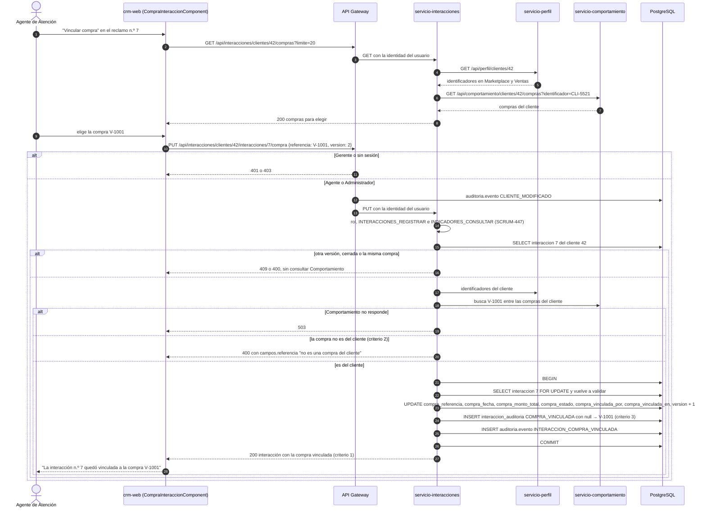

# Diagramas de la vinculación de interacciones con compras (SCRUM-607)

Diagrama de clases y de secuencia de SCRUM-54. La regla de asociación, la API y la auditoría están en
`docs/interacciones/vinculacion-compras.md`. Están escritos en Mermaid: GitHub los dibuja al abrir este archivo, y
para adjuntarlos a la historia en Jira se exportan como imagen desde <https://mermaid.live>.

## Diagrama de clases

```mermaid
classDiagram
    direction LR

    class InteraccionesClienteComponent {
        <<Angular>>
        +compraActualizada(interaccion)
    }
    class CompraInteraccionComponent {
        <<Angular, SCRUM-444>>
        +interaccion
        +texto
        +abrir()
        +buscar()
        +vincular(compra)
        +quitar()
    }
    class InteraccionesService {
        <<Angular>>
        +comprasElegibles(clienteId, texto, limite)
        +vincularCompra(clienteId, id, referencia, version)
        +desvincularCompra(clienteId, id, version)
    }
    class SecurityConfig {
        <<API Gateway>>
        GET: INTERACCIONES_CONSULTAR
        PUT y DELETE: INTERACCIONES_REGISTRAR
    }
    class ComprasElegiblesController {
        <<SCRUM-446>>
        +consultar(clienteId, texto, limite, req) ComprasElegibles
    }
    class ServicioComprasElegibles {
        <<SCRUM-446>>
        +consultar(clienteId, texto, limite) ComprasElegibles
    }
    class InteraccionesController {
        +vincularCompra(clienteId, id, solicitud, req) Interaccion
        +desvincularCompra(clienteId, id, version, req) Interaccion
    }
    class IdentidadGateway {
        <<SCRUM-447>>
        +historialCliente(req) Identidad
        +vinculacionCompra(req) Identidad
    }
    class SolicitudVinculacion {
        <<record>>
        +String referencia
        +Long version
    }
    class ServicioInteracciones {
        <<SCRUM-446 y SCRUM-447>>
        +vincularCompra(clienteId, id, solicitud, identidad) Interaccion
        +desvincularCompra(clienteId, id, version, identidad) Interaccion
        -validarVinculacion(interaccion, version, referencia)
    }
    class ClientesPerfil {
        <<HTTP a servicio-perfil>>
        +identificadores(clienteId) Optional~List~
    }
    class ComprasCliente {
        <<HTTP a servicio-comportamiento>>
        +elegibles(clienteId, ids, texto, limite) ComprasRecientes
        +buscar(clienteId, ids, referencia) Optional~Compra~
    }
    class RegistroInteracciones {
        <<repository, SCRUM-445>>
        +bloquear(clienteId, id) Optional~Interaccion~
        +vincularCompra(id, referencia, fecha, monto, estado, usuario) Interaccion
        +desvincularCompra(id) Interaccion
    }
    class AuditoriaInteracciones {
        <<repository, SCRUM-448>>
        +compra(interaccion, usuario, rol, anterior, nueva)
    }
    class Interaccion {
        <<record>>
        +long id
        +String estado
        +long version
        +CompraVinculada compra
    }
    class CompraVinculada {
        <<record, SCRUM-445>>
        +String referencia
        +OffsetDateTime fecha
        +BigDecimal montoTotal
        +String estado
        +String vinculadaPor
        +OffsetDateTime vinculadaEn
    }

    InteraccionesClienteComponent --> CompraInteraccionComponent : una por interacción
    CompraInteraccionComponent --> InteraccionesService
    InteraccionesService ..> SecurityConfig : HTTP con el token
    SecurityConfig ..> ComprasElegiblesController : X-Usuario, X-Usuario-Rol, X-Usuario-Permisos
    SecurityConfig ..> InteraccionesController
    ComprasElegiblesController --> ServicioComprasElegibles
    ComprasElegiblesController ..> IdentidadGateway
    InteraccionesController ..> IdentidadGateway
    InteraccionesController ..> SolicitudVinculacion
    InteraccionesController --> ServicioInteracciones
    ServicioComprasElegibles --> ClientesPerfil
    ServicioComprasElegibles --> ComprasCliente
    ServicioInteracciones --> ClientesPerfil
    ServicioInteracciones --> ComprasCliente
    ServicioInteracciones --> RegistroInteracciones
    ServicioInteracciones --> AuditoriaInteracciones : COMPRA_VINCULADA e INTERACCION_COMPRA_VINCULADA
    RegistroInteracciones ..> Interaccion
    Interaccion *-- CompraVinculada : 0..1
```

## Diagrama de secuencia: vincular una compra a un reclamo

