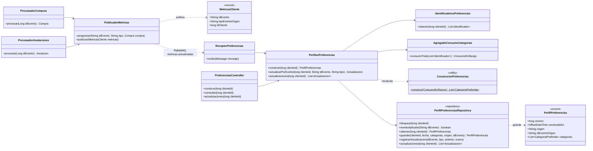
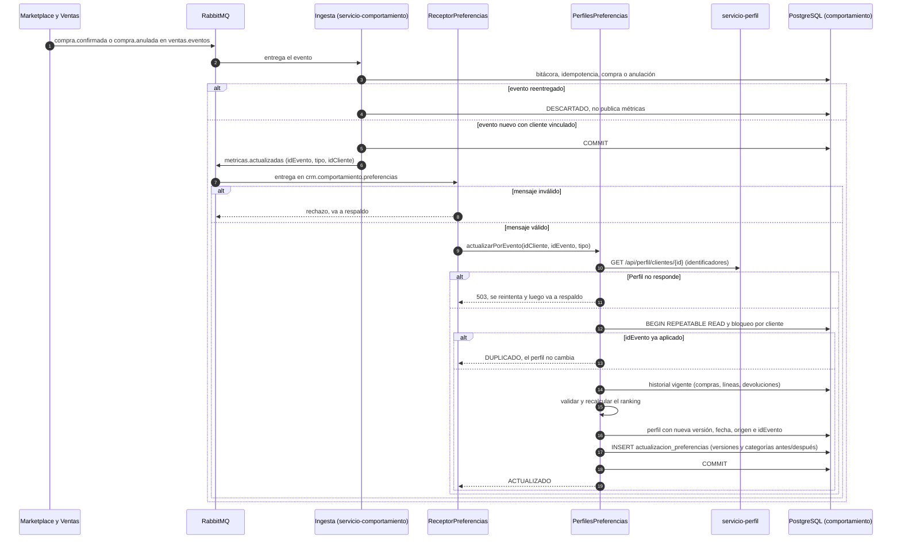

# Diagramas de la actualización del perfil de preferencias por eventos (SCRUM-589)

Diagrama de clases y diagrama de secuencia de SCRUM-42. La lógica está en
`docs/preferencias/actualizacion-por-eventos.md`. Están escritos en Mermaid: GitHub los dibuja al
abrir este archivo, y para adjuntarlos a la historia en Jira se exportan como imagen desde
<https://mermaid.live>.

## Diagrama de clases

## Diagrama de secuencia: compra confirmada, reentrega y anulación

