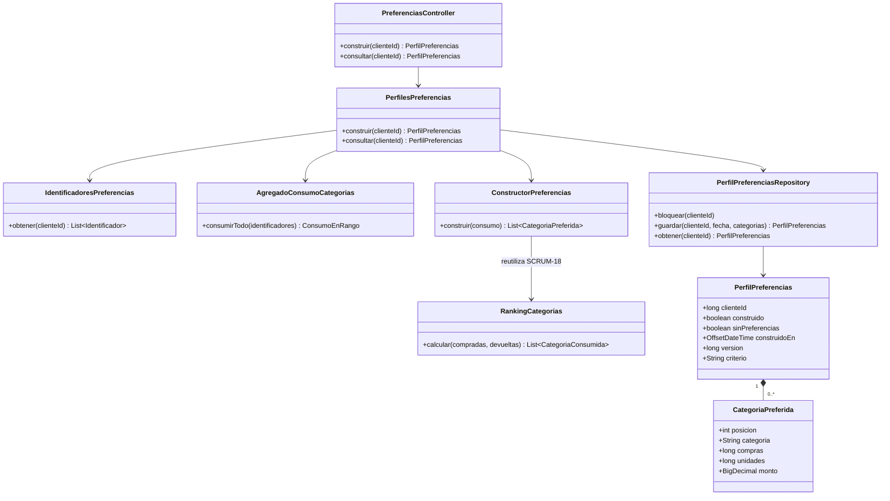
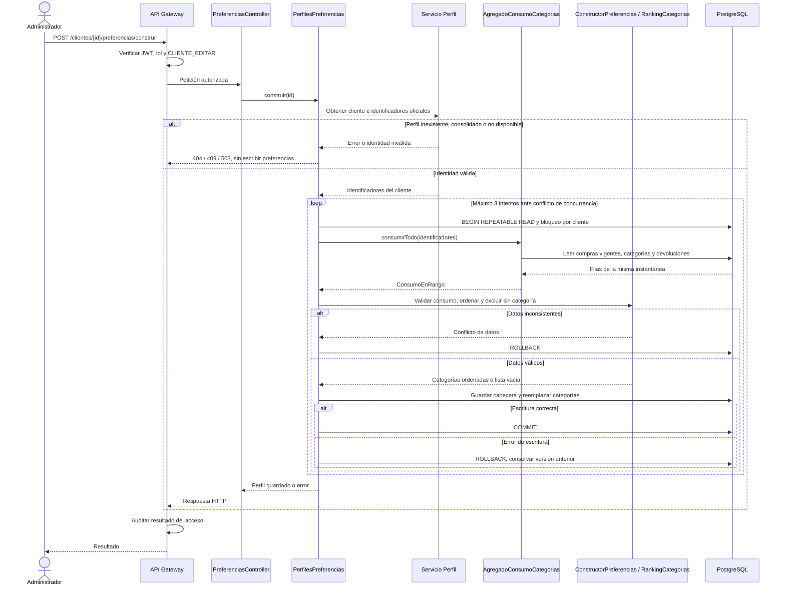

# Diagramas de SCRUM-41

Modelo y reglas: [perfil de preferencias](perfil-preferencias.md).

## Clases

Fuente editable: [clases.mmd](clases.mmd).

## Secuencia de construcción

Fuente editable: [secuencia.mmd](secuencia.mmd).

