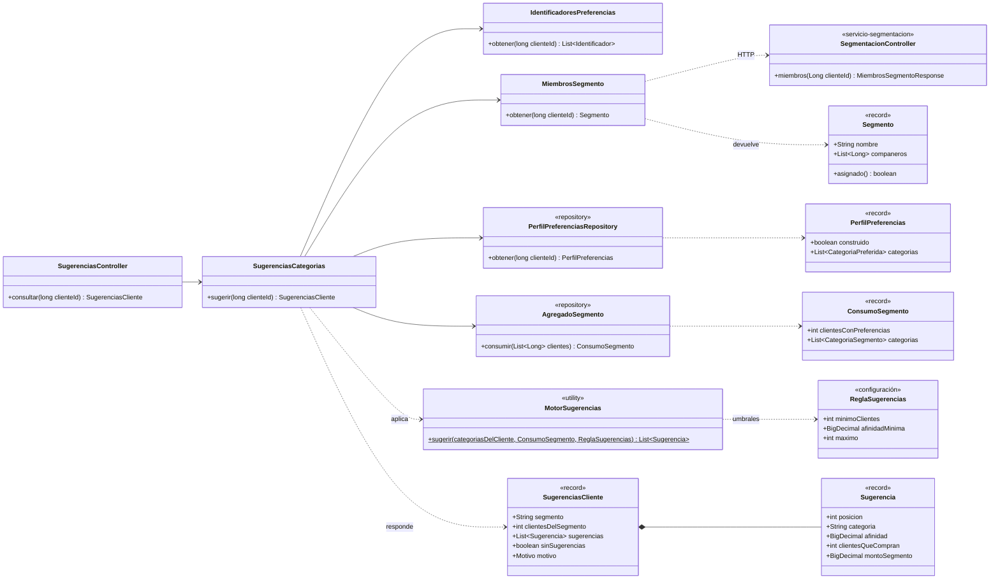
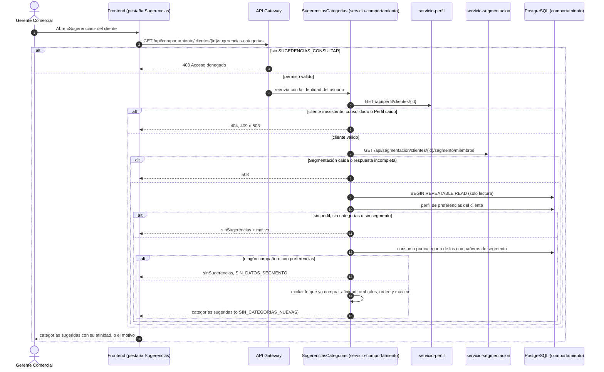

# Diagramas de la sugerencia de categorías afines (SCRUM-591)

Diagrama de clases y diagrama de secuencia de SCRUM-44. El criterio está en
`docs/preferencias/sugerencia-categorias.md`. Están escritos en Mermaid: GitHub los dibuja al abrir
este archivo, y para adjuntarlos a la historia en Jira se exportan como imagen desde
<https://mermaid.live>.

## Diagrama de clases

## Diagrama de secuencia: generación y consulta de sugerencias

