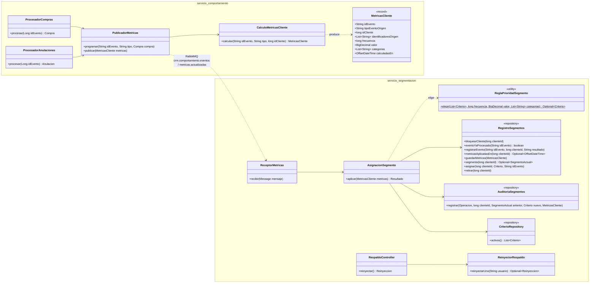
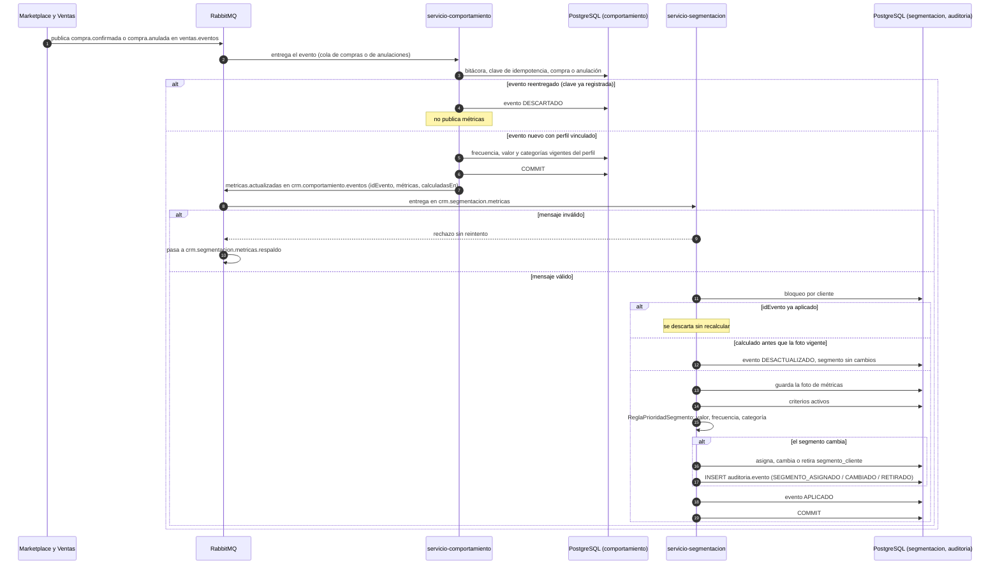

# Diagramas de la asignación automática de segmento (SCRUM-574)

Diagrama de clases y diagrama de secuencia de la integración asíncrona de SCRUM-26. La lógica está en
`docs/segmentacion/asignacion-automatica.md`. Están escritos en Mermaid: GitHub los dibuja al abrir
este archivo, y para adjuntarlos a la historia en Jira se exportan como imagen desde
<https://mermaid.live>.

## Diagrama de clases

## Diagrama de secuencia: compra, reentrega y anulación

