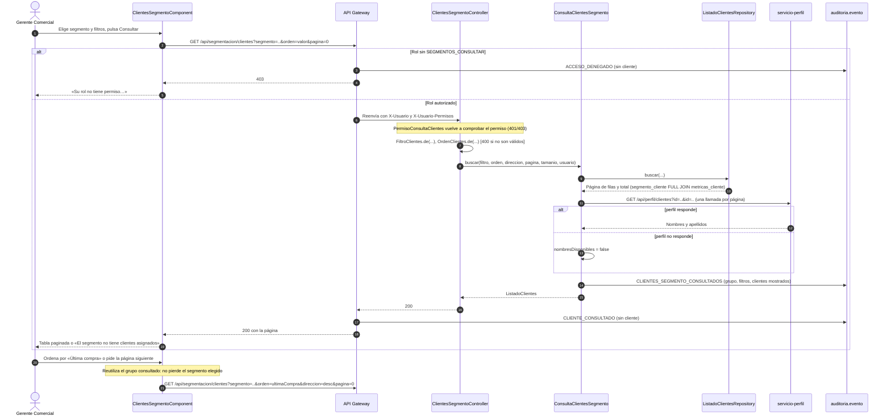
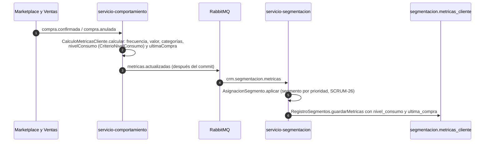

# Diagramas de la consulta de clientes por segmento (SCRUM-576)

Diagrama de clases y diagramas de secuencia de SCRUM-28. El criterio de consulta está en
`docs/segmentacion/criterio-consulta-clientes.md` y el uso, en `docs/segmentacion/clientes-por-segmento.md`.
Están escritos en Mermaid: GitHub los dibuja al abrir este archivo, y para adjuntarlos a la historia
en Jira se exportan como imagen desde <https://mermaid.live>.

## Diagrama de clases

```mermaid
classDiagram
    direction LR

    namespace frontend {
        class ClientesSegmentoComponent {
            +filtro FiltroClientesSegmento
            +consultado Signal~FiltroClientesSegmento~
            +orden Signal~OrdenClientes~
            +direccion Signal~Direccion~
            +consultar()
            +ordenarPor(OrdenClientes columna)
            +buscar(number pagina)
        }
        class ClientesSegmentoService {
            +segmentos() Observable~List~SegmentoDisponible~~
            +buscar(filtro, orden, direccion, pagina, tamanio) Observable~PaginaClientesSegmento~
        }
        class PaginacionComponent {
            +pagina number
            +tamanio number
            +total number
            +cambiar EventEmitter~number~
        }
    }

    namespace servicio_segmentacion {
        class PermisoConsultaClientes {
            <<WebMvcConfigurer>>
            +addInterceptors(InterceptorRegistry)
        }
        class ClientesSegmentoController {
            +buscar(segmento, nivelConsumo, desde, hasta, orden, direccion, pagina, tamanio, usuario) ListadoClientes
            +segmentos() List~SegmentoDisponible~
        }
        class ConsultaClientesSegmento {
            +buscar(FiltroClientes, OrdenClientes, Direccion, int pagina, int tamanio, String usuario) ListadoClientes
            +segmentos() List~SegmentoDisponible~
        }
        class FiltroClientes {
            <<record>>
            +String segmento
            +NivelConsumo nivelConsumo
            +LocalDate ultimaCompraDesde
            +LocalDate ultimaCompraHasta
            +de(String, String, LocalDate, LocalDate)$ FiltroClientes
        }
        class OrdenClientes {
            <<enumeration>>
            VALOR
            NIVEL_CONSUMO
            ULTIMA_COMPRA
            FRECUENCIA
            SEGMENTO
            ASIGNADO_EN
            +de(String)$ OrdenClientes
        }
        class ListadoClientesRepository {
            <<repository>>
            +buscar(FiltroClientes, OrdenClientes, Direccion, int, int) PaginaFilas
            +segmentos() List~SegmentoDisponible~
        }
        class PerfilesClientes {
            +buscar(Collection~Long~ clienteIds) NombresClientes
        }
        class AuditoriaConsultaClientes {
            <<repository>>
            +registrar(usuario, FiltroClientes, OrdenClientes, Direccion, pagina, tamanio, total, clientes)
        }
        class ListadoClientes {
            <<record>>
            +List~Cliente~ content
            +int pagina
            +int tamanio
            +long total
            +String orden
            +String direccion
            +boolean nombresDisponibles
        }
        class RegistroSegmentos {
            <<repository>>
            +guardarMetricas(MetricasCliente)
        }
        class MetricasCliente {
            <<record>>
            +Long idCliente
            +Long frecuencia
            +BigDecimal valor
            +String nivelConsumo
            +OffsetDateTime ultimaCompra
        }
        class NivelConsumo {
            <<enumeration>>
            BAJO
            MEDIO
            ALTO
        }
    }

    namespace servicio_comportamiento {
        class CalculoMetricasCliente {
            +calcular(String idEvento, String tipo, long idCliente) MetricasCliente
        }
        class CriterioNivelConsumo {
            +clasificar(BigDecimal valor) Optional~NivelConsumo~
        }
    }

    namespace servicio_perfil {
        class PerfilController {
            +porIdentificadores(List~Long~ ids) List~ResumenPerfil~
        }
        class ConsultaPerfil {
            +resumenes(List~Long~ ids) List~ResumenPerfil~
        }
    }

    ClientesSegmentoComponent --> ClientesSegmentoService
    ClientesSegmentoComponent --> PaginacionComponent
    ClientesSegmentoService ..> ClientesSegmentoController : HTTP vía API Gateway
    PermisoConsultaClientes ..> ClientesSegmentoController : SEGMENTOS_CONSULTAR
    ClientesSegmentoController --> ConsultaClientesSegmento
    ClientesSegmentoController ..> FiltroClientes
    ClientesSegmentoController ..> OrdenClientes
    ConsultaClientesSegmento --> ListadoClientesRepository
    ConsultaClientesSegmento --> PerfilesClientes
    ConsultaClientesSegmento --> AuditoriaConsultaClientes
    ConsultaClientesSegmento ..> ListadoClientes
    FiltroClientes --> NivelConsumo
    PerfilesClientes ..> PerfilController : HTTP interno
    PerfilController --> ConsultaPerfil
    CalculoMetricasCliente --> CriterioNivelConsumo
    CalculoMetricasCliente ..> MetricasCliente : publica por RabbitMQ
    RegistroSegmentos ..> MetricasCliente
    ListadoClientesRepository ..> RegistroSegmentos : lee metricas_cliente y segmento_cliente
```

## Diagrama de secuencia: consulta de un segmento

## Diagrama de secuencia: de dónde salen el nivel y la última compra

