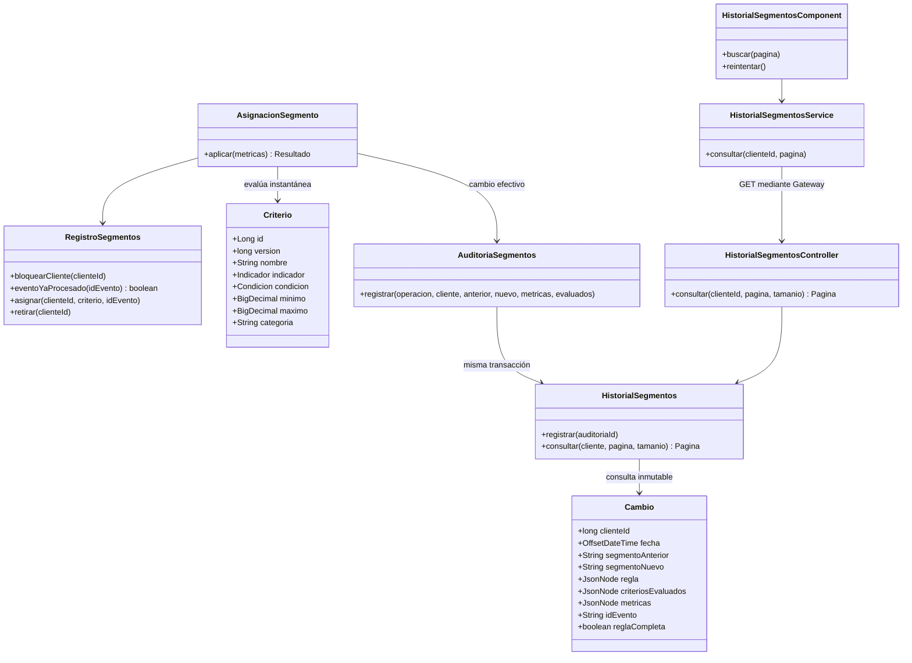
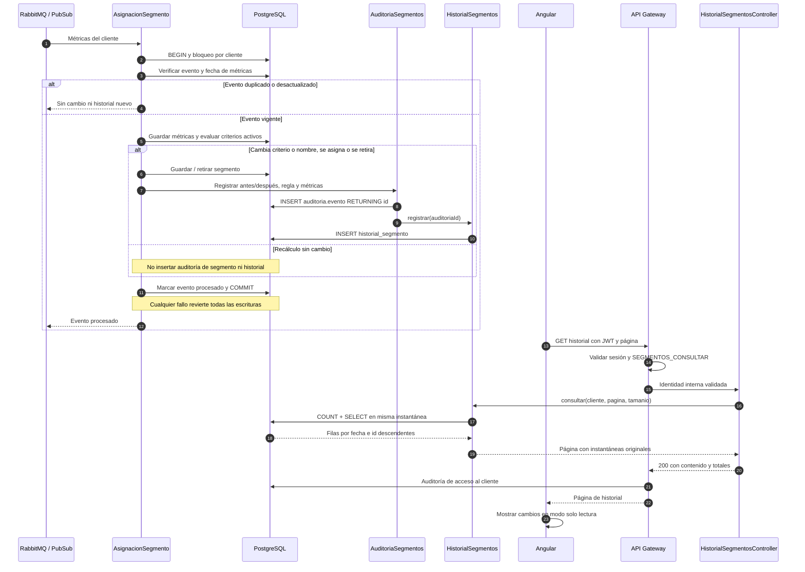

# Diagramas del historial de segmentos — SCRUM-578

## Clases

## Registro y consulta

La tabla tiene restricciones únicas y triggers que rechazan UPDATE, DELETE y TRUNCATE. El endpoint solo implementa GET; el gateway deniega los métodos de escritura.
