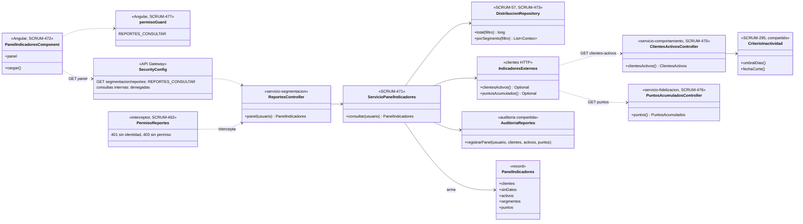
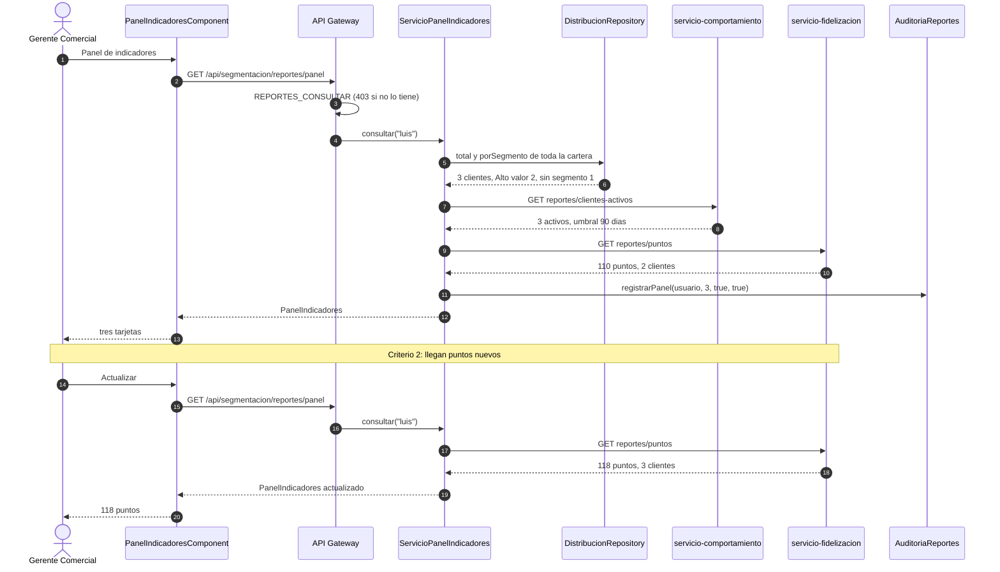
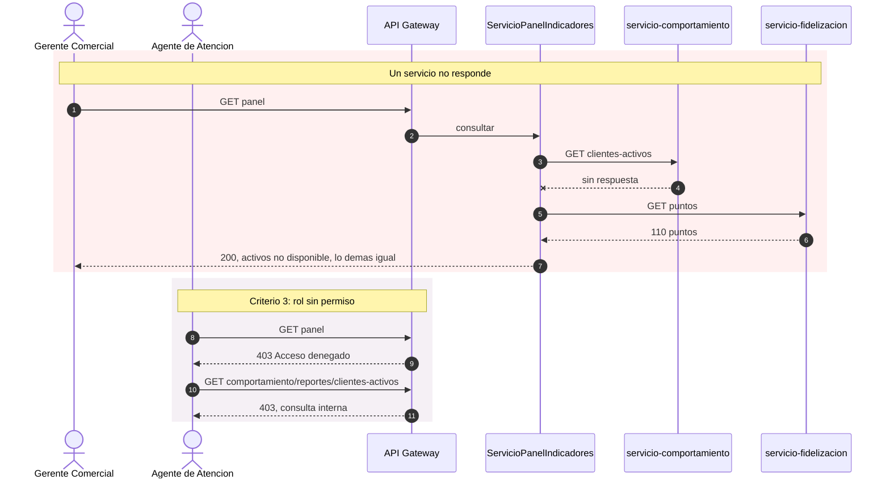

# Diagramas del panel de indicadores de clientes (SCRUM-611)

Diagrama de clases y de secuencia de SCRUM-59. Las métricas, la consolidación y los permisos están en
[panel-indicadores.md](panel-indicadores.md). Están escritos en Mermaid: GitHub los dibuja al abrir este
archivo, y para adjuntarlos a la historia en Jira se exportan como imagen.

## Diagrama de clases

## Diagrama de secuencia

Apertura del panel y actualización.

Los casos que no son el normal.

