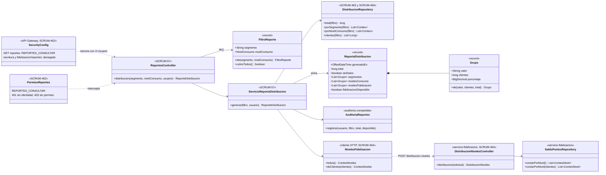
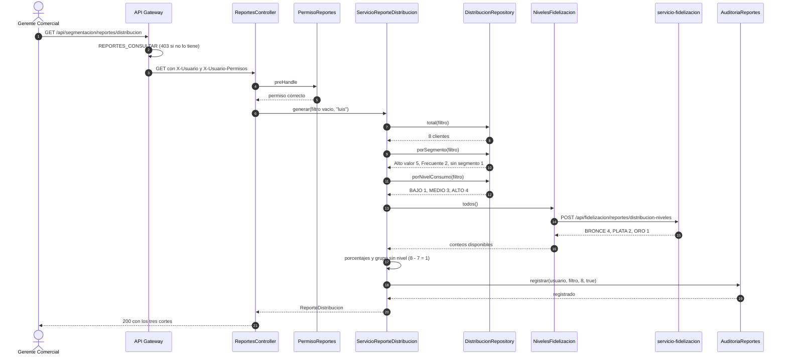
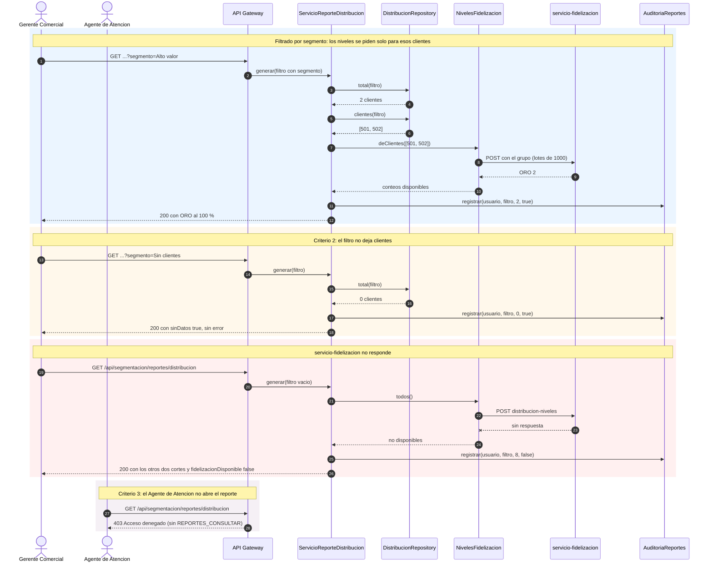

# Diagramas del reporte de distribución de clientes (SCRUM-609)

Diagrama de clases y de secuencia de SCRUM-57. Los criterios, las fuentes de datos y los permisos
están en [reportes-distribucion.md](reportes-distribucion.md). Están escritos en Mermaid: GitHub los
dibuja al abrir este archivo, y para adjuntarlos a la historia en Jira se exportan como imagen desde
<https://mermaid.live>.

## Diagrama de clases

## Diagrama de secuencia

Reporte sin filtro: los tres cortes sobre toda la población.

Reporte filtrado y los dos casos que no son el normal: sin datos y fidelización caída.

