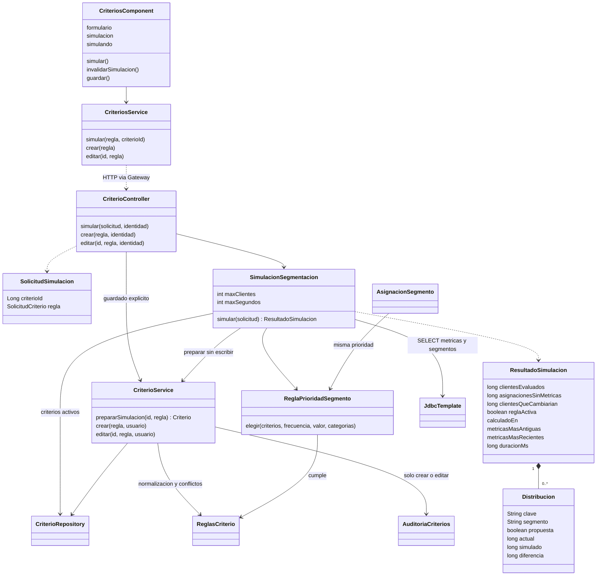
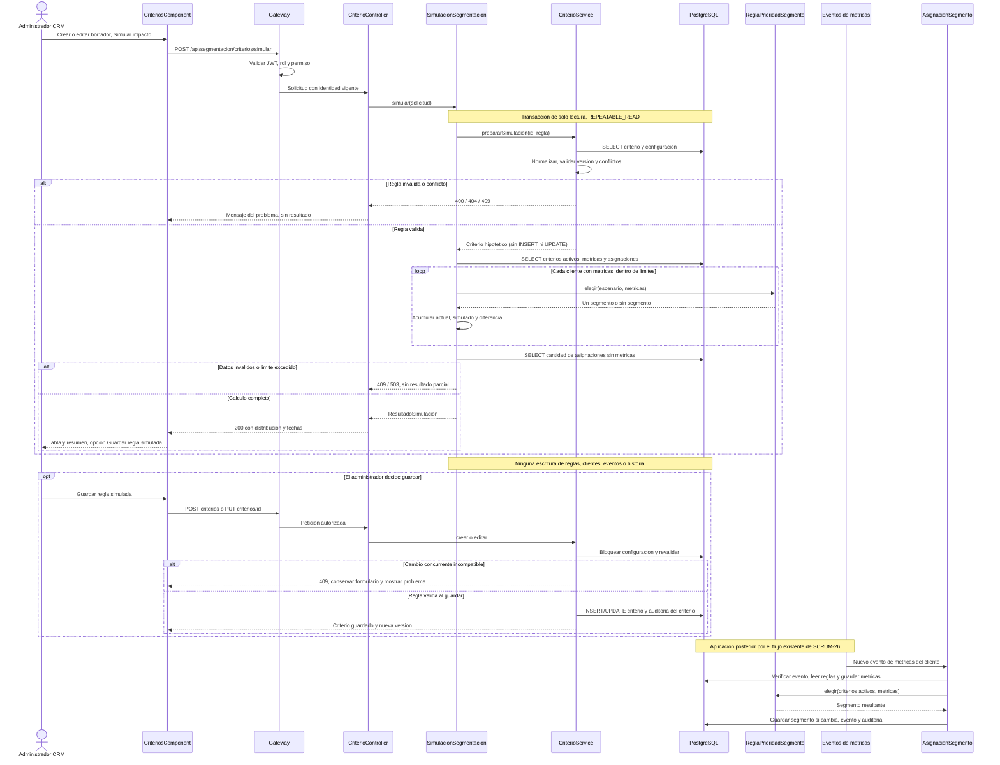

# SCRUM-577 · Diagramas de SCRUM-29

Corresponden a la [implementación de simulación](simulacion.md). Versiones exportadas: [clases SVG](simulacion-clases.svg) y [secuencia SVG](simulacion-secuencia.svg). Fuentes editables: [clases Mermaid](simulacion-clases.mmd) y [secuencia Mermaid](simulacion-secuencia.mmd).

## Clases

## Secuencia: simular, guardar y aplicar posteriormente

La simulación no llama a `AsignacionSegmento`. Ese participante figura únicamente para explicar la aplicación posterior del criterio guardado. Los errores de autenticación terminan en el Gateway antes de entrar al simulador. Un cambio de formulario cancela la suscripción HTTP y elimina la previsualización; una nueva simulación obtiene otra instantánea.
