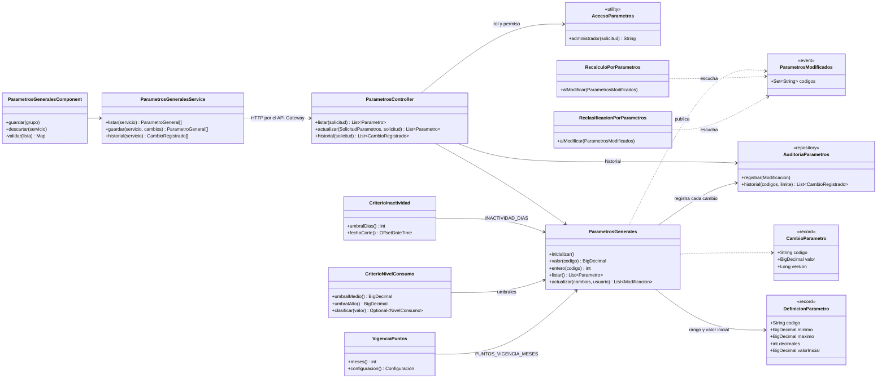
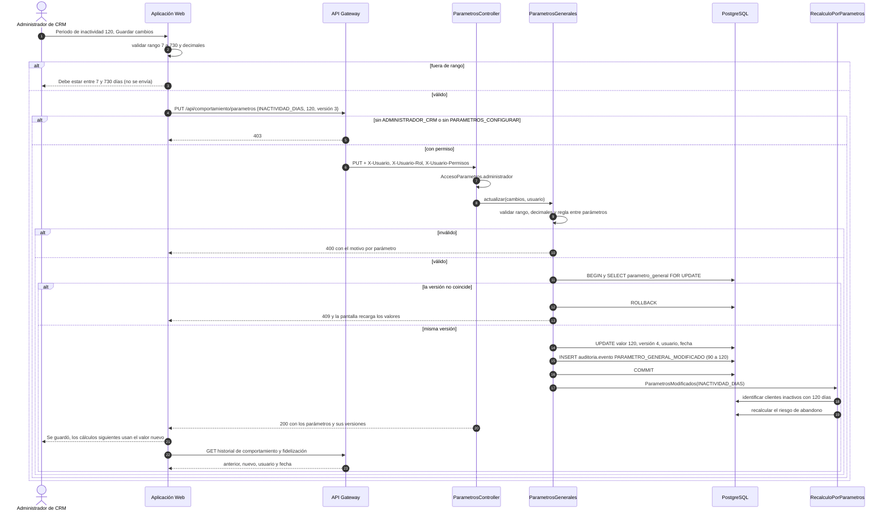
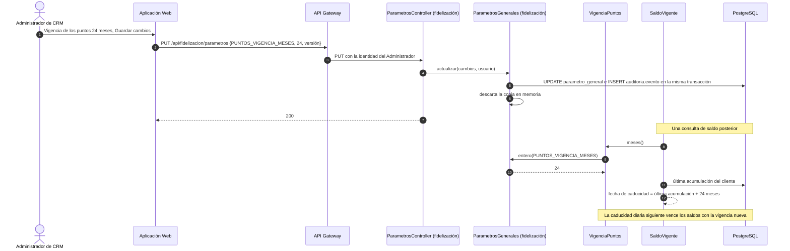

# Diagramas de los parámetros generales del CRM · SCRUM-65 / SCRUM-615

## Diagrama de clases

`ParametrosGenerales`, `ParametrosController`, `AccesoParametros` y `AuditoriaParametros` existen en
servicio-comportamiento (inactividad y umbrales) y en servicio-fidelizacion (vigencia de puntos), cada uno con su
tabla `parametro_general`.

## Diagrama de secuencia: cambiar el periodo de inactividad

## Diagrama de secuencia: la vigencia de los puntos rige en la consulta siguiente

